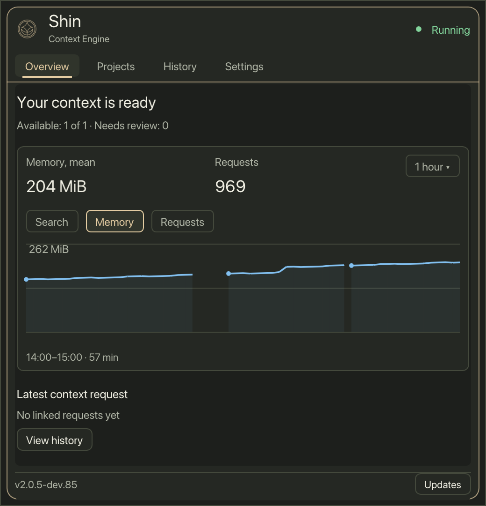
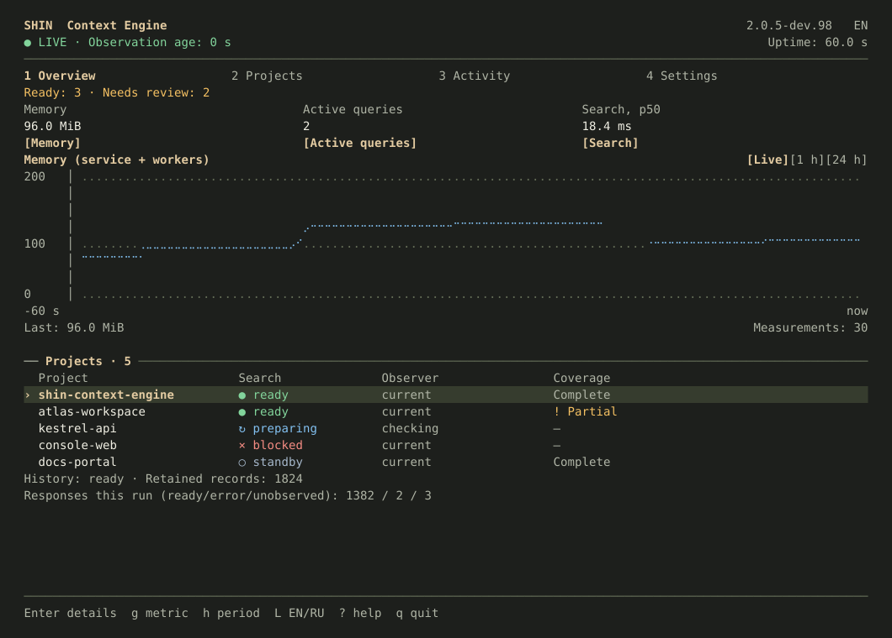

#  Shin Context Engine

[](https://github.com/toseek-samurai/shin-context-engine/actions/runs/42536688388)

**Fresh code and documentation context for coding agents.**

Shin indexes your project locally, watches for changes, and gives your coding
agent focused evidence through **MCP or a native CLI**. Find unfamiliar code,
check the relevant contracts, and inspect the matching source without loading
the whole repository into every conversation.

Local retrieval needs no account, model download, embedding service or cloud
inference API. Your coding agent keeps its own model and workflow.

[Download preview dev.110](https://github.com/toseek-samurai/shin-context-engine/releases/tag/v2.0.5-dev.110) ·
[macOS setup](#get-started-on-macos) · [Windows setup](docs/windows-desktop.md#download-a-preview) ·
[Linux / WSL2](docs/building.md#linux-and-wsl2-terminal-tools) ·
[Connect your coding agent](docs/native-client-setup.md)

**Development preview:** macOS 15+ Apple Silicon, Windows x64 ZIP/MSI, and
Ubuntu 24.04 x86_64 terminal archives are available. There is no stable release yet.
See [platform support](docs/README.md#capabilities-by-platform) for the differences
in desktop, terminal and update support.

## From a question to source

1. **Add a folder.** Use Monitor's project setup or run `shin-ce init` in the project.
2. **Choose your agents.** Setup discovers supported clients and shows which
   configurations will change, preserving their other settings.
3. **Ask and inspect.** Use your connected agent or the CLI:

```sh
shin-ce query "Where are requests validated?"
```

Results include source paths, evidence and a snapshot identifier. Follow that
snapshot with `inspect` and `read` to examine the matching source; changed files
require fresh evidence. See the [inspection commands](docs/cli.md#inspect-evidence).
For a known file or symbol, your agent can still read it directly.

## See your project's state

**Shin Monitor** puts readiness, project analytics and recent activity in a
dark Sand interface. macOS uses a menu bar popup. On Windows, the notification
icon opens a quick status panel, with a separate desktop window for the full
Monitor. Both support English and Russian.

<p>
  
  
</p>

- **Overview:** see which projects are available and follow memory and request activity.
- **Projects:** connect folders and agents, inspect search response times, and understand warnings.
- **History:** review recorded calls, session activity, timing and optional agent usage.
- **Settings:** change language, inspect storage and check for updates.

Project setup stays visible while a folder is prepared, showing the current
stage and elapsed time. Partial coverage, preparation and blocked states have
separate explanations; available verified context remains usable when a warning
permits it.

Screenshots use synthetic data, not private projects or benchmark results.
[Native EN/RU gallery and capture sources](docs/images/README.md) ·
[Windows screenshots and behavior](docs/windows-desktop.md).

## Follow agent sessions


History groups recorded MCP calls and explicit client events by session.
Timing and agent token usage are separate: a client's token totals do not count
Shin calls, and missing session or model metadata stays unknown.
The journal shows up to 48 recent events while retaining its separate history
and analysis totals. See [what is recorded](docs/cli.md#sessions-and-optional-recovery-notes-dev45).

## Also in your terminal

```sh
shin-ce stats
```



The macOS/Linux terminal monitor uses the same project-state and timing
calculations. Navigate **Overview**, **Projects**, **Activity** and **Settings**
with Tab or 1–4; press `?` for help and `l` to switch EN/RU.
Native macOS update review and progress are available under Settings / Updates.

[Terminal screen gallery](docs/tui.md) · [CLI guide and keyboard controls](docs/cli.md).
These native FTXUI captures also use synthetic data; terminal fonts and colors vary.

## Get started on macOS

Install the [current native preview](https://github.com/toseek-samurai/shin-context-engine/releases/tag/v2.0.5-dev.110):

```sh
curl -fsSL https://github.com/toseek-samurai/shin-context-engine/releases/download/v2.0.5-dev.110/install.sh | sh
```

The installer downloads a versioned binary kit, verifies SHA-256 and installs it
for your user without `sudo` or a compiler. You can [inspect the script and archive](docs/local-kit.md#download-a-preview-release)
first. The preview is ad-hoc signed and not notarized; macOS may require manual
approval on first launch.

Open Monitor, then use its project setup to add a folder and choose agents:

```sh
open "$HOME/.local/opt/shin-local/Shin Monitor.app"
```

For terminal setup:

```sh
export PATH="$HOME/.local/bin:$PATH"
cd /path/to/your/project
shin-ce init
shin-ce status --text
shin-ce query "Where are requests validated?"
```

The `PATH` change applies to this terminal session; installation leaves shell
startup files unchanged. Indexes and history stay in a separate private data
home. Adding a project does not add configuration files to its source tree.

Monitor checks for complete published updates and offers a review before
installation. Its independent Updater shows download, staging and activation
progress. [Installation, startup, updates and recovery](docs/local-kit.md) ·
[Automatic and manual agent connections](docs/native-client-setup.md).

## Install with Homebrew

The project-owned tap builds the complete macOS application, including Monitor,
CLI/TUI and MCP:

```sh
brew install toseek-samurai/tap/shin-context-engine
shin-monitor
```

**The tap currently pins dev.70**, an older preview than the native download above.
Its UI and update behavior follow that version. The first installation builds
from source and can take several minutes; Apple Silicon installation has been
qualified, while Intel qualification is incomplete. Homebrew owns updates through
`brew upgrade`. [Homebrew setup and lifecycle](docs/homebrew.md).

## Choose the component you need

| Route | Included | Get started |
| --- | --- | --- |
| macOS 15+ Apple Silicon | Core, local service, CLI/TUI, MCP, usage collector and Monitor | [Native kit](docs/local-kit.md) or [Homebrew](docs/homebrew.md) |
| Windows x64 on local NTFS | Core, local service, CLI, MCP, usage collector and Win32/DX11 Monitor | [ZIP/MSI preview](docs/windows-desktop.md#download-a-preview) |
| Ubuntu 24.04 x86_64 / WSL2 | Core, local service, CLI/TUI, MCP and usage collector | [Terminal archive or source build](docs/building.md#linux-and-wsl2-terminal-tools) |
| Core for tools and integrations | C++ indexing, bounded retrieval and snapshot-bound source reads | [Build from source](docs/building.md#core) |

Windows does not yet provide the TUI. Linux has no native desktop host, OS service
installer or automatic package updater. The [capability matrix](docs/README.md#capabilities-by-platform)
describes the supported setup and update routes. Configuring a coding agent may
send retrieved context to that agent's chosen model provider.

[Documentation](docs/README.md) · [Architecture](docs/architecture.md) ·
[Contribute](CONTRIBUTING.md) · [Report a bug or suggest a feature](https://github.com/toseek-samurai/shin-context-engine/issues/new/choose)

Core and Observer are versioned independently: Core [`VERSION`](VERSION) and
[Observer version](observer/VERSION). Published packages and current development
source can differ; see [release and source identities](docs/README.md#current-preview)
and the [machine-readable manifest](docs/machine/shin-context-engine.manifest.json).

Licensed under [Apache-2.0](LICENSE). [Third-party notices](THIRD_PARTY.md) ·
[Private security reporting](SECURITY.md).

<p align="center">
  <a href="docs/local-kit.md"></a>
  <a href="docs/building.md#linux-and-wsl2-terminal-tools"></a>
  <a href="docs/windows-desktop.md"></a>
</p>
