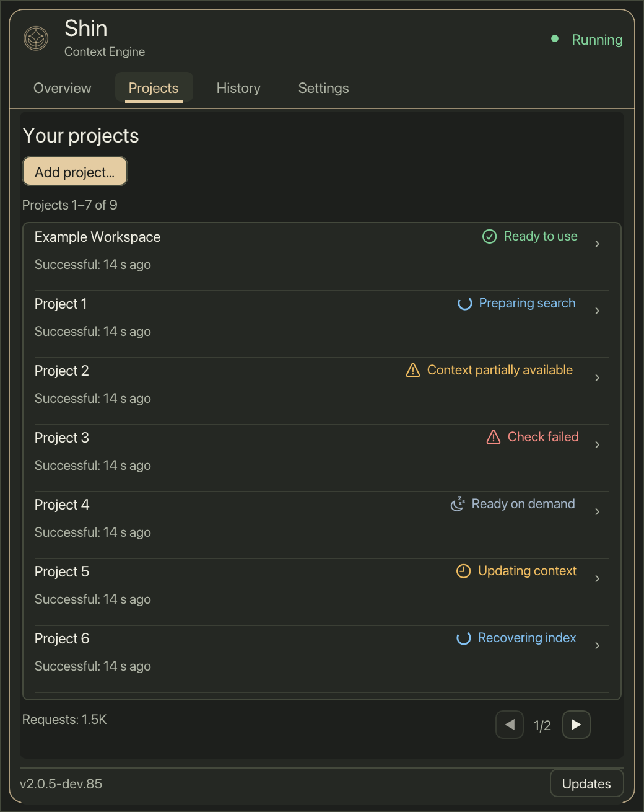
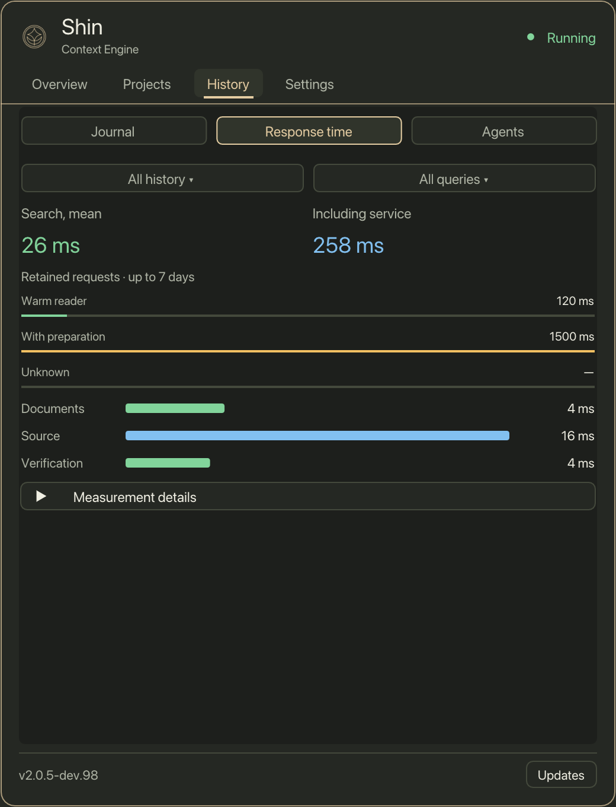
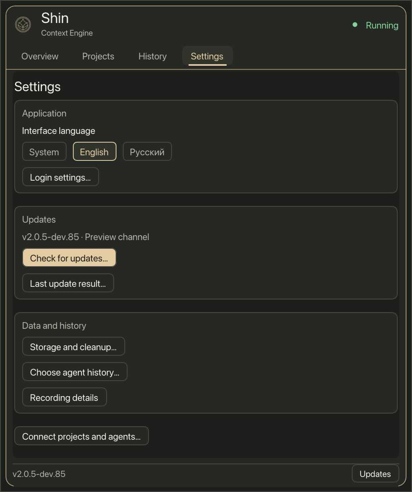
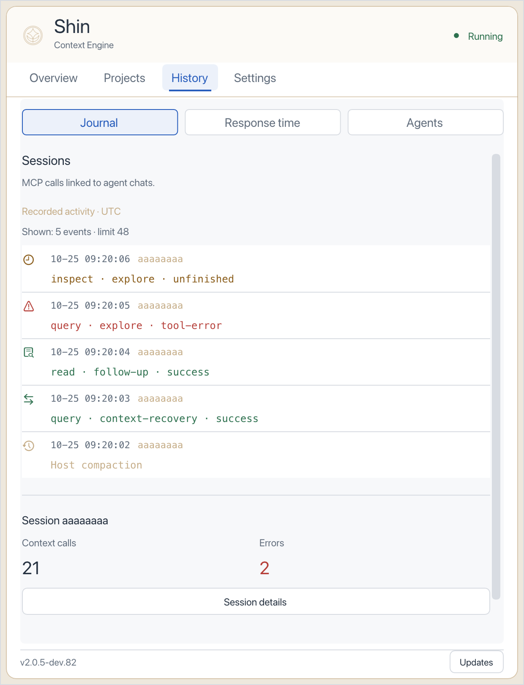
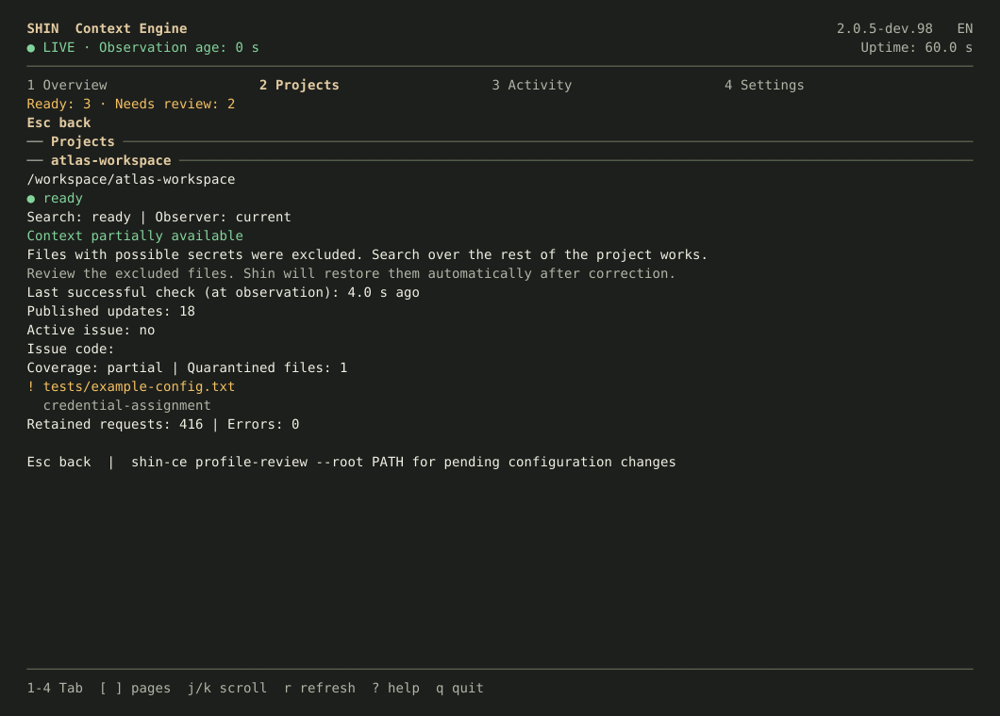
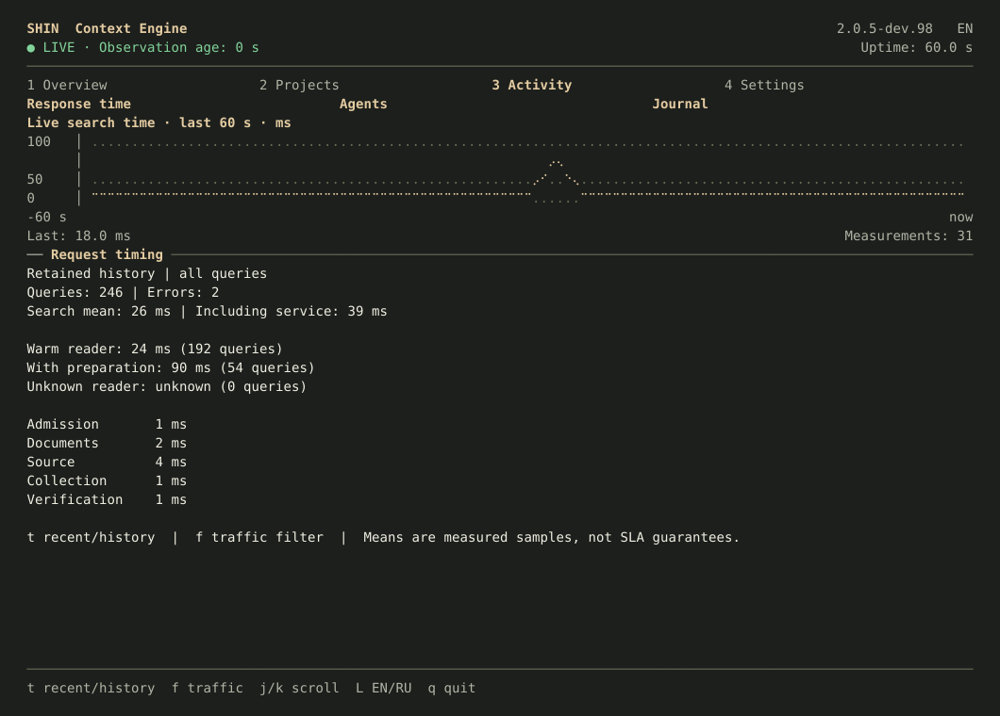

#  Shin Context Engine

[](https://github.com/toseek-samurai/shin-context-engine/actions/workflows/ci.yml)

**Fresh code and documentation context for coding agents.**

Shin indexes your project locally, watches for changes, and returns focused
context through **MCP or a native CLI**. Its C++ engine needs no account, model
download, or cloud inference API for local retrieval.

Use it to find unfamiliar code, retrieve related documentation, and pick up a
task with evidence your agent can inspect. Query results carry a snapshot that
binds subsequent inspection and reads to the matching source.

[Download preview](https://github.com/toseek-samurai/shin-context-engine/releases/tag/v2.0.5-dev.77) ·
[macOS setup](#get-started-on-macos) · [Windows setup](docs/windows-desktop.md#download-a-preview) ·
[Linux / WSL2](docs/building.md#linux-and-wsl2-terminal-tools) ·
[Connect your coding agent](docs/native-client-setup.md)

**Development preview:** macOS Apple Silicon and Windows x64 packages are
available; Linux and WSL2 build from source. There is no stable release yet.
Platform capabilities differ; see the [component table](#choose-the-component-you-need)
and [Windows scope](docs/windows-desktop.md).

[Report a bug or suggest a feature](https://github.com/toseek-samurai/shin-context-engine/issues/new/choose) ·
[Documentation and platform support](docs/README.md) · [CLI guide](docs/cli.md) · [Architecture](docs/architecture.md) · [Contribute](CONTRIBUTING.md)

## From a question to source

After adding a project through the setup guide above, ask your connected agent
to use Shin, or run a query from the project's directory:

```sh
shin-ce query "Where are requests validated?"
```

Follow the returned paths and snapshot with `inspect` and `read` to examine the
matching source. The same evidence flow is available through MCP; your agent
can fetch context when it needs it. See the [inspection commands](docs/cli.md#inspect-evidence).

## See your project's state

**Shin Monitor** shows project readiness, request history, timings, storage and
optional model usage. The macOS kit includes a menu bar app; the Windows preview
includes its native desktop host. On macOS and Linux, `shin-ce stats` opens the
Sand terminal monitor with the same project states and timing calculations.

The screenshots below show the **current development UI**: the original dark
Sand palette with compact navigation, readable 14 px body text and a panel that
fits short pages instead of leaving empty space below them. These refinements
are not yet included in a published preview; dev.85 uses Light Sand.

<p>
  
  
</p>
<p>
  
  
</p>

Monitor uses **Overview**, **Projects**, **History** and **Settings**. Overview
shows availability and recent activity; Projects connects folders and coding
agents. History opens with recorded calls, with timing and optional model usage
available separately. Technical reports stay in expandable details rather than
competing with everyday actions.

These native macOS Monitor renders use synthetic sample data. Windows uses the
same dashboard, but its setup and update controls differ; see the
[capability matrix](docs/README.md#capabilities-by-platform).
Monitor supports English and Russian; these examples use English. Names, counts,
and timings above are examples, not benchmark results.
[Screenshot sources and reproduction](docs/images/README.md).

- **See freshness and failures.** Monitor distinguishes current, preparing,
  partial, and blocked project states, with a next step when action is needed.
- **Ask for focused evidence.** Query from your terminal or coding agent, then
  inspect and read using the returned snapshot.
- **Keep state outside your repository.** The native kit stores indexes and
  history in a separate private data directory. Adding a project does not add
  configuration files to its source tree.
- **Use the same local service from UI and CLI.** Desktop and TUI use the same
  project states and timing calculations. The desktop redesign calls its activity
  section History; the terminal keeps Activity. Text and JSON status remain available. See the
  [UI-to-CLI map](docs/cli.md#monitor-and-cli).

## Follow agent sessions



In the desktop redesign, **History** opens with recent MCP calls and
explicit client events, session counters and expandable details. Up to eight
sessions and six events per session keep the view bounded; this display limit
does not reduce stored history or analysis totals. The screenshot uses synthetic
data. Earlier dark desktop previews and the terminal keep this journal under
**Activity → Journal**. See [Sessions and recording boundaries](docs/cli.md#sessions-and-optional-recovery-notes-dev45)
and the [Russian screenshot](docs/images/monitor-sessions-ru.png).

## Also in your terminal


`shin-ce stats` keeps its dark Sand palette. This native FTXUI render uses
synthetic example data; fonts and color support follow your terminal.
Sand TUI is included in preview dev.39 and later. The four-section layout shown
here is included in preview dev.66 and later. The desktop Light Sand redesign
does not change the terminal's appearance or keyboard controls.

<p>
  
  
</p>

[All terminal screens, including Russian and compact layouts](docs/tui.md) ·
[Keyboard controls and usage setup](docs/cli.md#interactive-terminal-monitor).

## Install with Homebrew

The project-owned tap builds the complete macOS preview, including Monitor,
CLI/TUI and MCP:

```sh
brew install toseek-samurai/tap/shin-context-engine
shin-monitor
```

This route targets macOS 15+ and is qualified on Apple Silicon; Intel installation
qualification remains incomplete. The first installation builds from source and
can take several minutes.
[Homebrew setup, agent connections, upgrades and removal](docs/homebrew.md).
Homebrew manages this package; use `brew upgrade` for updates.

## Get started on macOS

The preview includes a first-run setup window, automatic agent connections
and project statistics; see [guided setup](docs/native-client-setup.md#automatic-setup).

The [development preview](https://github.com/toseek-samurai/shin-context-engine/releases/tag/v2.0.5-dev.77)
is available for **macOS 15+ on Apple Silicon**. Install or update with:

```sh
curl -fsSL https://github.com/toseek-samurai/shin-context-engine/releases/download/v2.0.5-dev.77/install.sh | sh
```

The installer downloads a versioned binary kit, checks SHA-256, and installs it
for your user without `sudo` or a compiler. This preview is ad-hoc signed and
not notarized; macOS may require manual approval on first launch. You can also
[download and inspect the archive](docs/local-kit.md#download-a-preview-release),
[build from source](docs/local-kit.md#build-the-package), or test a
[CI candidate](docs/local-kit.md#download-a-ci-candidate).

Connect your first project:

```sh
export PATH="$HOME/.local/bin:$PATH"

cd /path/to/your/project
shin-ce init
shin-ce status --text
shin-ce query "Where are requests validated?"
```

`init` adds the current project and starts the local service. Initial preparation
can take time; use `status --text` to see whether search is ready. The `PATH`
change above applies to this terminal session; installation leaves your shell
startup files unchanged.

Open Monitor and click its menu bar icon:

```sh
open "$HOME/.local/opt/shin-local/Shin Monitor.app"
```

You can add further folders in Monitor or with
`shin-ce project-add --root /path/to/another/project`. For terminal-only use, run
`shin-ce stats` (or `shin-ce service-status --text` for a single status report).
In preview dev.66 and later, use Tab or 1–4 for **Overview**, **Projects**,
**Activity** and **Settings**. Left/Right or `[` / `]` switches pages inside
Activity and Settings; Enter opens project details and q exits. The journal lives
in Activity; updates live in Settings (shortcut `u`).
To use Shin from a coding agent,
[configure the included MCP adapter](docs/native-client-setup.md). Service and Monitor
startup at login are described in the
[installation guide](docs/local-kit.md#automatic-startup). For an existing kit,
follow the [update procedure](docs/local-kit.md#update-an-existing-kit), which preserves
project data and restores the previous kit if activation fails.

## Choose the component you need

| Component | What it does | Current build and distribution scope |
| --- | --- | --- |
| Local kit | Core, Observer, CLI, MCP, usage collector, and Monitor | macOS 15+ Apple Silicon preview; verified binary kit |
| Core | Indexing and bounded retrieval for tools and integrations | macOS, Linux and native Windows x64 source builds; [build instructions](docs/building.md) |
| Observer tools | Local service, CLI, and MCP; terminal monitor on macOS/Linux | macOS, Linux and Windows x64 source builds; [build instructions](docs/building.md) |
| Windows desktop preview | Native Observer/CLI/MCP and Win32/DX11 Monitor using the shared engine and UI | [ZIP/MSI preview assets](https://github.com/toseek-samurai/shin-context-engine/releases/tag/v2.0.5-dev.77) and [development checks](docs/building.md#native-windows-development-builds) |

Windows support adds platform adapters to the same Core, profiles and protocols.
Published ZIP/MSI previews pass the matching CI matrix and exact-package checks;
see the [Windows scope and remaining gates](docs/windows-desktop.md) for the
distinction between hosted checks, interactive tests and installation lifecycle.
Linux desktop packaging and complete macOS Intel installation
qualification remain pending. Configuring an AI client may send the context it retrieves to that
client's chosen model provider.

For contributors: [build and test](docs/building.md),
[contribution guidance](CONTRIBUTING.md), and the
[product manifest](docs/machine/shin-context-engine.manifest.json).
The root `VERSION` records [Core](VERSION); [Observer](observer/VERSION) is
versioned separately.

Licensed under [Apache-2.0](LICENSE). [Third-party notices](THIRD_PARTY.md)
and [private security reporting](SECURITY.md).

<p align="center">
  <a href="docs/local-kit.md"></a>
  <a href="docs/building.md#linux-and-wsl2-terminal-tools"></a>
  <a href="docs/windows-desktop.md"></a>
</p>
