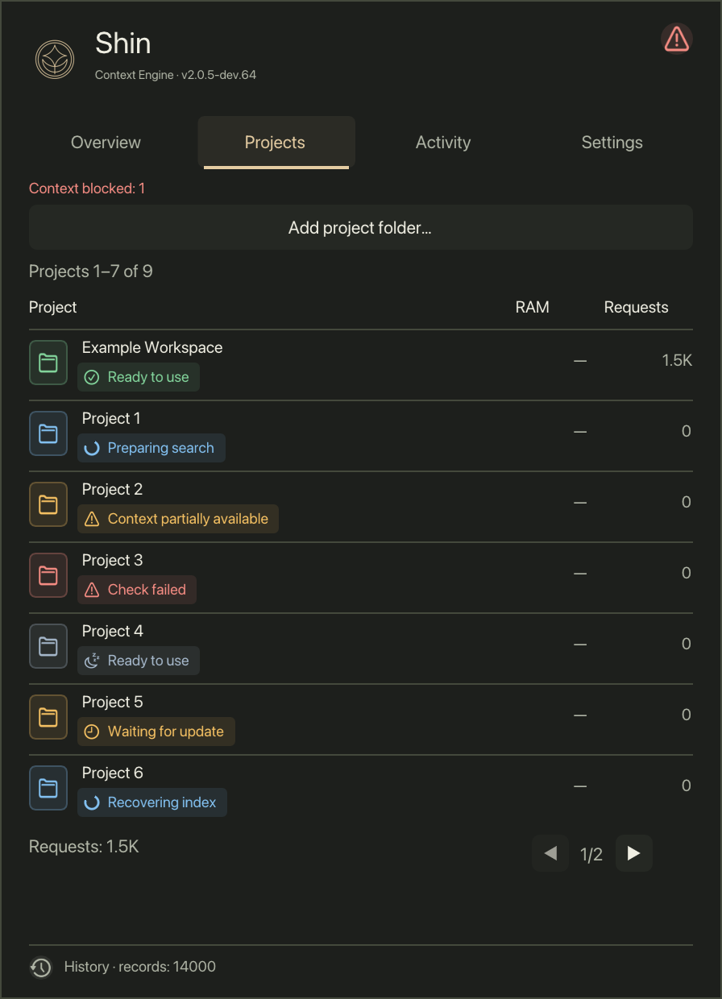
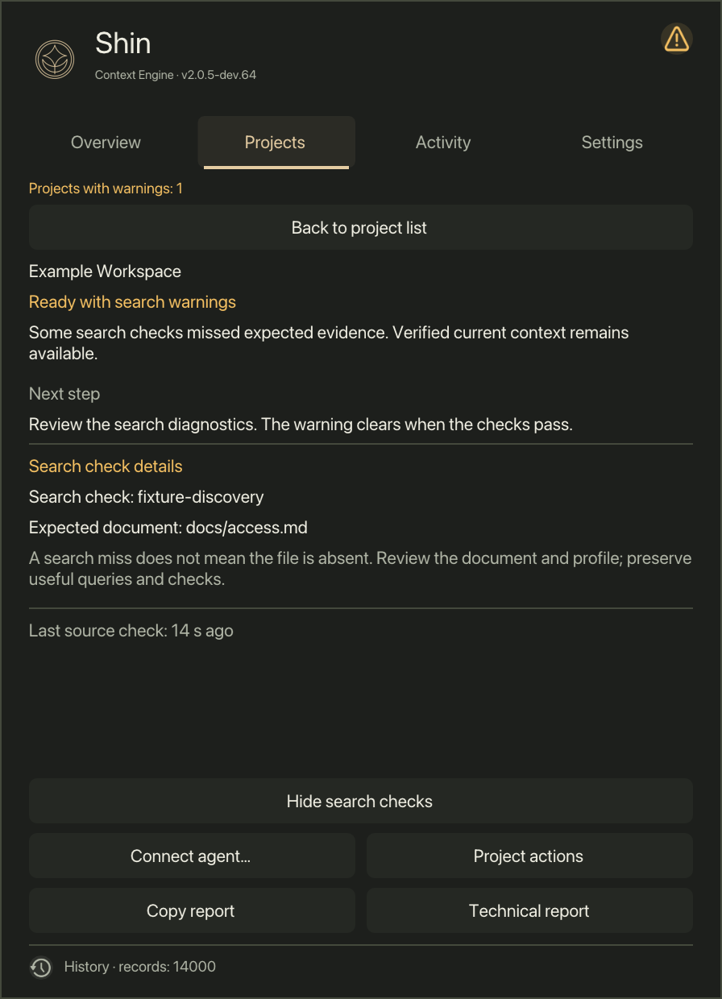
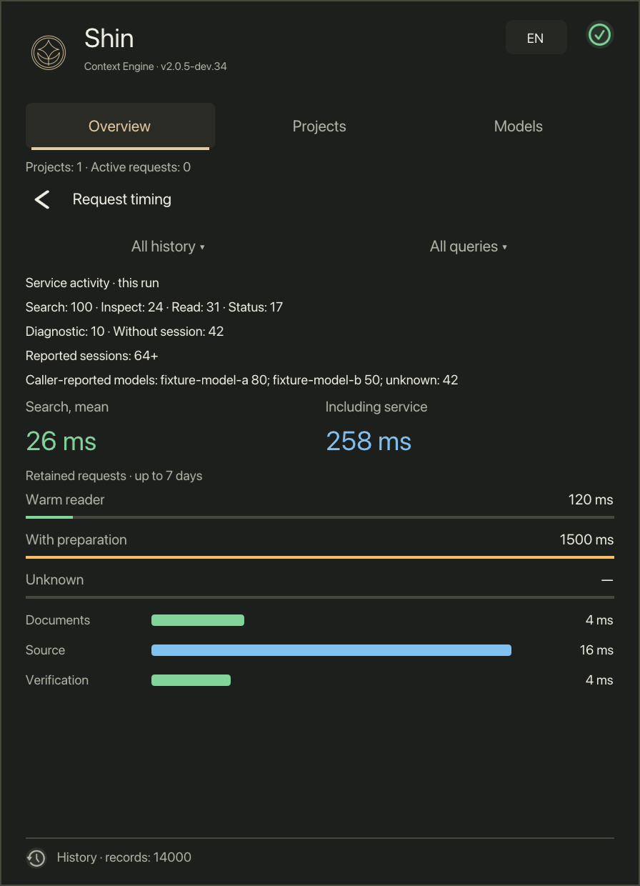
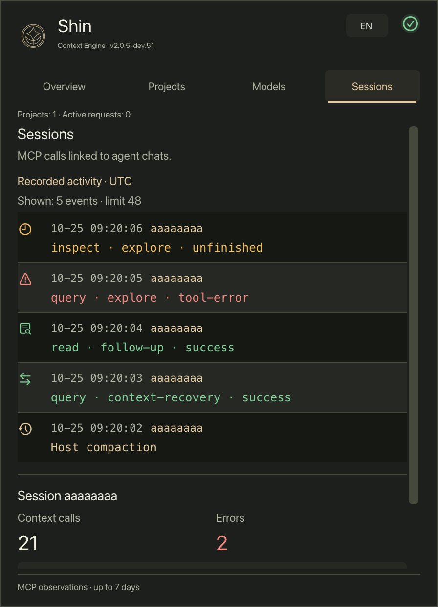
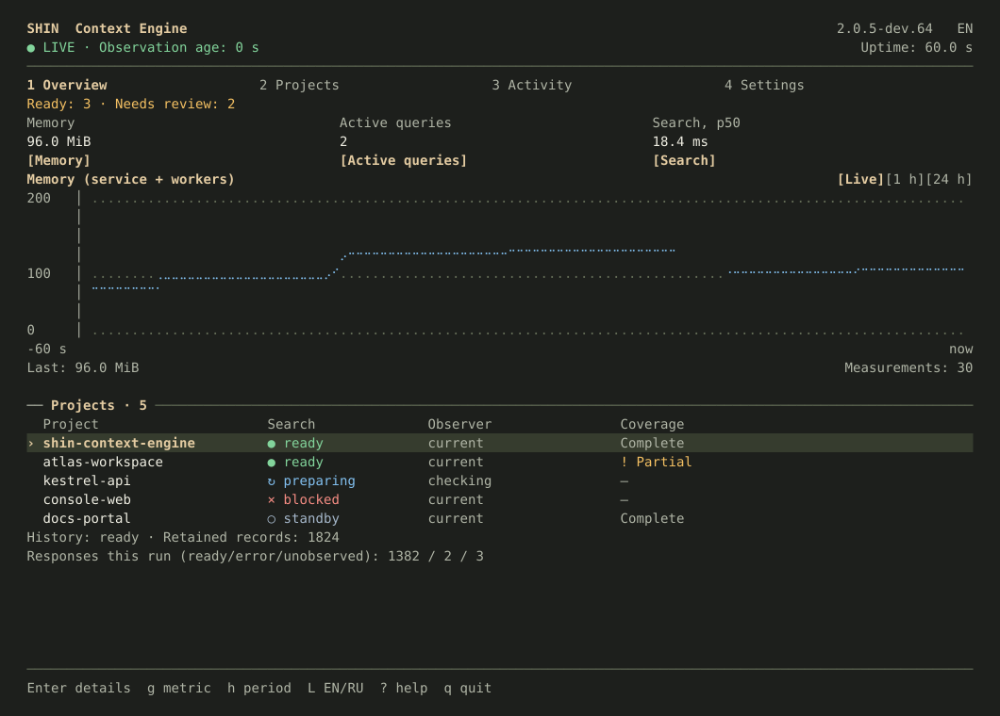
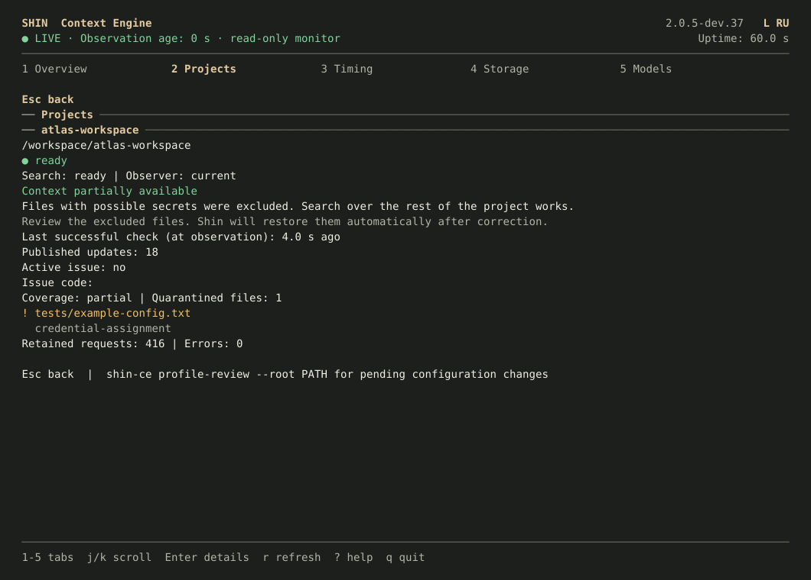
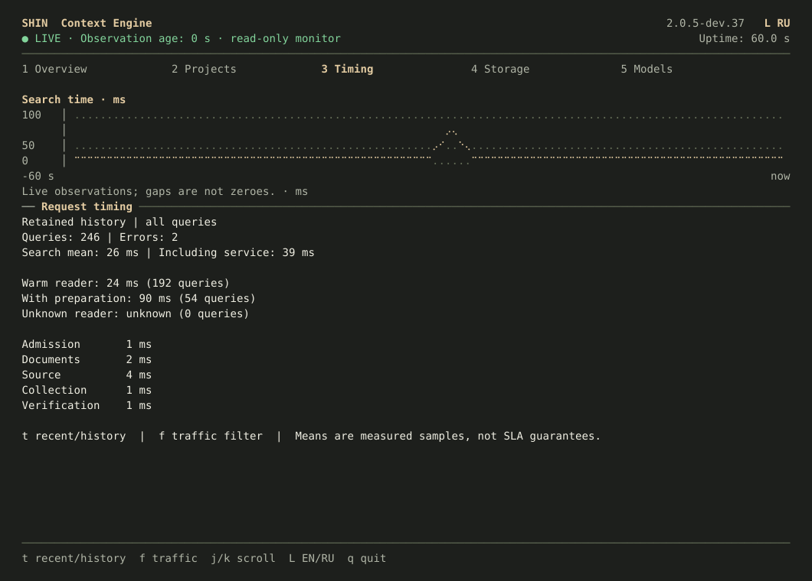

#  Shin Context Engine

[](https://github.com/toseek-samurai/shin-context-engine/actions/workflows/ci.yml)

**Keep project context current. Give coding agents evidence they can inspect.**

Shin indexes your project's source and documentation, watches for changes, and
returns focused context through a native CLI or MCP. Results carry a snapshot
that the client can use to inspect and read the matching source.

The local macOS kit includes the background service and **Shin Monitor**, a menu
bar app for project health, request history, timings, storage, and optional model
usage. Prefer a terminal? `shin-ce stats` opens an interactive monitor with the same
project states and timing calculations. Local retrieval needs no account, model
download, or cloud inference API.

**Development preview:** the source is available for review and testing.
There is no stable release yet. Development focuses on the portable local engine,
its CLI and MCP integrations, and the Monitor interface.

[Get started](#get-started-on-macos) · [CLI guide](docs/cli.md) ·
[Connect an MCP client](docs/native-client-setup.md) ·
[Build from source](docs/building.md) · [Windows source status](docs/windows-desktop.md) ·
[Architecture](docs/architecture.md)

[Report a bug or suggest a feature](https://github.com/toseek-samurai/shin-context-engine/issues/new/choose) ·
[Contribute](CONTRIBUTING.md)

## See your project's state

<p>
  
  
  
</p>

Sand appearance with distinct status colors, shown in real Monitor screens
rendered with synthetic sample data. Monitor supports
English and Russian; these examples use English. Names, counts, and timings above are examples, not benchmark results.
[Screenshot sources and reproduction](docs/images/README.md).

- **See freshness and failures.** Monitor distinguishes current, preparing,
  partial, and blocked project states, with a next step when action is needed.
- **Ask for focused evidence.** Query from your terminal or coding agent, then
  inspect and read using the returned snapshot.
- **Keep state outside your repository.** The native kit stores indexes and
  history in a separate private data directory. Adding a project does not add
  configuration files to its source tree.
- **Use the same local service from UI and CLI.** The TUI has overview, projects,
  timing, storage, and model-usage tabs. Text and JSON status remain available. See the
  [UI-to-CLI map](docs/cli.md#monitor-and-cli).

## Follow agent sessions



The dev.52 source adds a readable **Sessions** journal: recent MCP calls and
explicit client events, session counters and expandable details. Up to eight
sessions and six events per session keep the view bounded; this display limit
does not reduce stored history or analysis totals. The screenshot uses synthetic
data. See [Sessions and recording boundaries](docs/cli.md#sessions-and-optional-recovery-notes-dev45)
and the [Russian screenshot](docs/images/monitor-sessions-ru.png).

## Also in your terminal



`shin-ce stats` uses the same Sand palette as Monitor. This native FTXUI render
uses synthetic example data; fonts and color support follow your terminal.
Sand TUI is included in preview dev.39 and later.

<p>
  
  
</p>

[All terminal screens, including Russian and compact layouts](docs/tui.md) ·
[Keyboard controls and usage setup](docs/cli.md#interactive-terminal-monitor).

## Get started on macOS

The preview includes a first-run setup window, automatic agent connections
and project statistics; see [guided setup](docs/native-client-setup.md#automatic-setup).

The [development preview](https://github.com/toseek-samurai/shin-context-engine/releases/tag/v2.0.5-dev.57)
is available for **macOS 15+ on Apple Silicon**. Install or update with:

```sh
curl -fsSL https://github.com/toseek-samurai/shin-context-engine/releases/download/v2.0.5-dev.57/install.sh | sh
```

The installer downloads a versioned binary kit, checks SHA-256, and installs it
for your user without `sudo` or a compiler. This preview is ad-hoc signed and
not notarized; macOS may require manual approval on first launch. You can also
[download and inspect the archive](docs/local-kit.md#download-a-preview-release),
[build from source](docs/local-kit.md#build-the-package), or test a
[CI candidate](docs/local-kit.md#download-a-ci-candidate).

Connect your first project:

```sh
export PATH="$HOME/.local/bin:$PATH"

cd /path/to/your/project
shin-ce init
shin-ce status --text
shin-ce query "Where are requests validated?"
```

`init` adds the current project and starts the local service. Initial preparation
can take time; use `status --text` to see whether search is ready. The `PATH`
change above applies to this terminal session; installation leaves your shell
startup files unchanged.

Open Monitor and click its menu bar icon:

```sh
open "$HOME/.local/opt/shin-local/Shin Monitor.app"
```

You can add further folders in Monitor or with
`shin-ce project-add --root /path/to/another/project`. For terminal-only use, run
`shin-ce stats` (or `shin-ce service-status --text` for a single status report).
Use Tab or 1–7 to switch views, Enter for project details, and q to exit.
**Sessions** is view 6; **Updates** is view 7.
To use Shin from a coding agent,
[configure the included MCP adapter](docs/native-client-setup.md). Automatic
startup at login is a separate opt-in step in the
[installation guide](docs/local-kit.md#automatic-startup). For an existing kit,
follow the [update procedure](docs/local-kit.md#update-an-existing-kit), which preserves
project data and restores the previous kit if activation fails.

## Choose the component you need

| Component | What it does | Current build and distribution scope |
| --- | --- | --- |
| Local kit | Core, Observer, CLI, MCP, usage collector, and Monitor | macOS 15+ Apple Silicon preview; verified binary kit |
| Core | Indexing and bounded retrieval for tools and integrations | macOS, Linux and native Windows x64 source builds; [build instructions](docs/building.md) |
| Observer tools | Local service, CLI, and MCP; terminal monitor on macOS/Linux | macOS and Linux source builds; [Linux/WSL instructions](docs/building.md#linux-and-wsl2-terminal-tools) |
| Windows desktop source | Native Observer/CLI/MCP and Win32/DX11 Monitor using the shared engine and UI | [Development builds and checks](docs/building.md#native-windows-development-builds); guarded ZIP/MSI publisher in unreleased source |

Windows support adds platform adapters to the same Core, profiles and protocols.
Its source checks do not qualify a Windows installer or imply feature parity;
see the [Windows scope and remaining gates](docs/windows-desktop.md).
Linux desktop packaging and macOS Intel package
qualification remain pending. Configuring an AI client may send the context it retrieves to that
client's chosen model provider.

For contributors: [build and test](docs/building.md),
[contribution guidance](CONTRIBUTING.md), and the
[product manifest](docs/machine/shin-context-engine.manifest.json).
The root `VERSION` records [Core](VERSION); [Observer](observer/VERSION) is
versioned separately.

Licensed under [Apache-2.0](LICENSE). [Third-party notices](THIRD_PARTY.md)
and [private security reporting](SECURITY.md).

<p align="center">
  <a href="docs/local-kit.md"></a>
  <a href="docs/building.md#linux-and-wsl2-terminal-tools"></a>
  <a href="docs/windows-desktop.md"></a>
</p>
