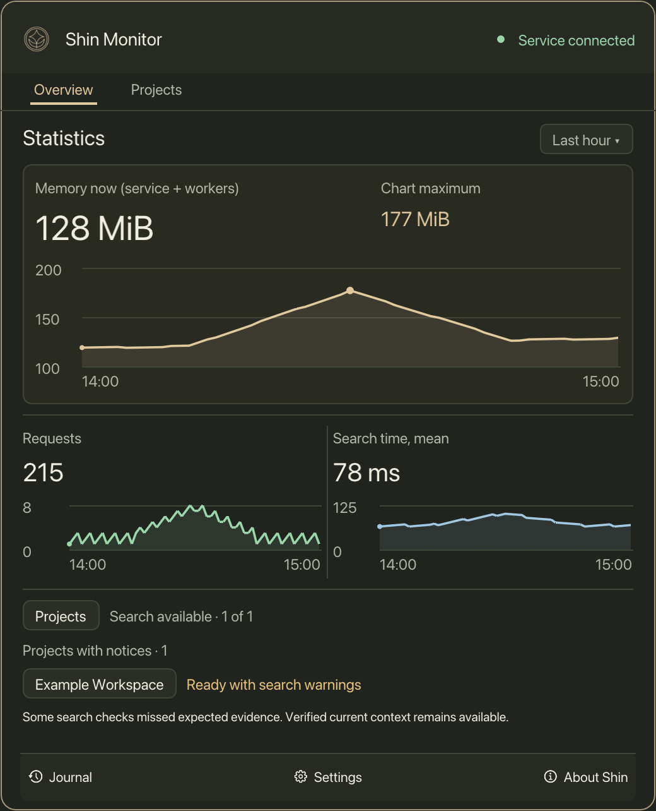
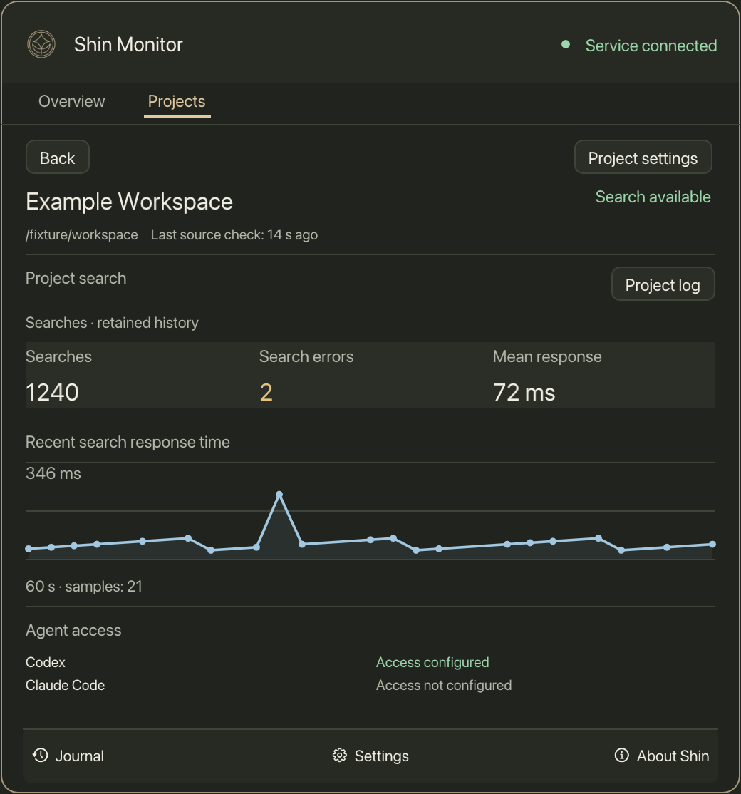
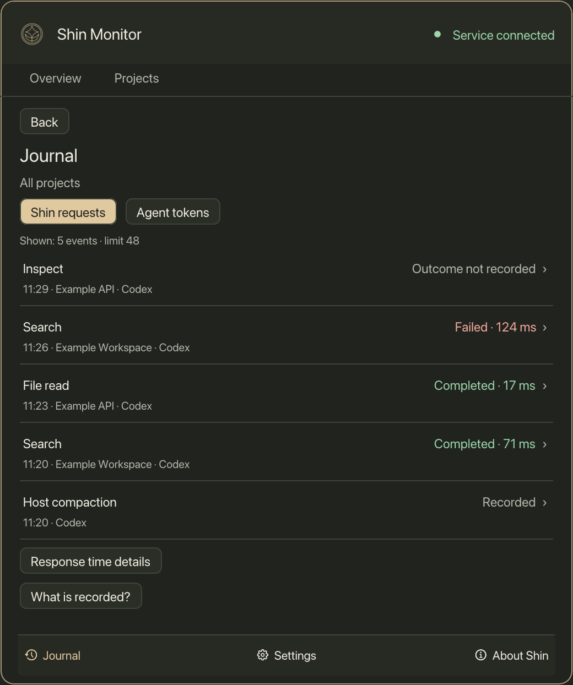
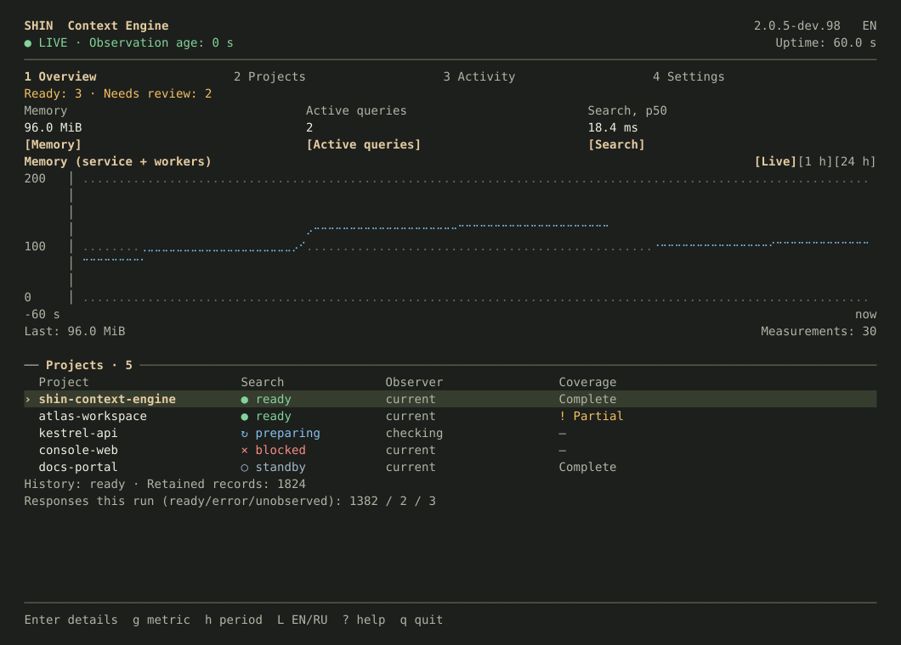

#  Shin Context Engine

[](https://github.com/toseek-samurai/shin-context-engine/releases/tag/v2.0.5-dev.134)

**Local code and documentation context for coding agents.**

Shin indexes your project, watches for changes and gives your agent focused
source evidence through **MCP or a native CLI**. Use it to find unfamiliar code,
understand a contract or gather context across projects; follow the result's
snapshot to inspect the matching source.

Local retrieval needs no account, model download, embedding service or cloud
inference API. Your coding agent keeps its own model and workflow.

[Documentation](docs/README.md) · [Connect your agent](docs/native-client-setup.md) ·
[Download preview dev.134](https://github.com/toseek-samurai/shin-context-engine/releases/tag/v2.0.5-dev.134)

**Development preview.** The documented download baseline is dev.134, with
qualified macOS, Windows and Linux packages. There is no stable release yet.
[Source, package identities and platform support](docs/README.md#current-preview).

## Get started on macOS

On **macOS 15+ with Apple Silicon**, install the versioned native kit:

```sh
curl -fsSL https://github.com/toseek-samurai/shin-context-engine/releases/download/v2.0.5-dev.134/install.sh | sh
open "$HOME/.local/opt/shin-local/Shin Monitor.app"
```

The installer downloads the binary kit, verifies SHA-256 and installs it for your
user without `sudo` or a compiler. You can [inspect the script and archive](docs/local-kit.md#download-a-preview-release)
first. This preview is ad-hoc signed and not notarized; macOS may require approval
on first launch.

| Platform / package | Start here | Updates |
| --- | --- | --- |
| macOS 15+ Apple Silicon | Native kit above: Monitor, CLI/TUI, MCP and local service | Review in Monitor or CLI/TUI; independent Updater shows progress |
| macOS Homebrew | [Complete application from the project tap](#install-with-homebrew) | `brew upgrade` |
| Windows x64, local NTFS | [MSI or portable ZIP](docs/windows-desktop.md#download-a-preview), including Monitor, CLI, MCP and local service | Monitor downloads and verifies MSI; Windows Installer requests UAC |
| Ubuntu 24.04 x86_64 / WSL2 | [Terminal archive or source build](docs/building.md#linux-and-wsl2-terminal-tools), including CLI/TUI, MCP and local service | Replace the archive or rebuild |

Windows TUI is not implemented. Linux has no native desktop host, OS service
installer or automatic package updater. See the [capability matrix](docs/README.md#capabilities-by-platform).

### Install with Homebrew

The project-owned tap builds the full macOS application, including Monitor:

```sh
brew install toseek-samurai/tap/shin-context-engine
shin-monitor
```

The first source build can take several minutes. The tap has its own qualified
version, which can lag native downloads; inspect it with
`brew info toseek-samurai/tap/shin-context-engine`.
[Homebrew setup and lifecycle](docs/homebrew.md).

## Connect your project and agent

1. **Add a folder** in Monitor. Setup stays visible while Shin prepares it,
   with the current stage and elapsed time.
2. **Choose discovered agents.** Review the configuration changes, then apply
   them. Shin preserves their other settings and shows access for each agent.
3. **Ask and inspect.** A connected agent can discover code and follow
   snapshot-bound evidence. For a known file or symbol, it can read it directly.

The dev.135 development build adds [Claude Code setup](docs/native-client-setup.md#claude-code)
in Monitor. Connect the selected folder and install the optional `shin-context`
skill from the same screen.

For terminal setup after a native macOS installation:

```sh
export PATH="$HOME/.local/bin:$PATH"
cd /path/to/your/project
shin-ce init
shin-ce status --text
shin-ce query "Where are requests validated?"
```

`init` registers the folder and normally starts the local service. Connect your
agents with the [reviewed CLI setup](docs/native-client-setup.md#automatic-setup);
registration and agent access are separate steps. The `PATH` change above lasts
for this terminal session; installation leaves shell startup files unchanged.

Choose a project folder and the agents that may use it.
Shin discovers eligible text throughout the folder, including files
with unfamiliar names or extensions. It follows the folder’s `.gitignore` rules
and watches additions, edits, moves and removals. An optional root `.shinignore`
can hide more paths or include a specific Git-ignored file. Setup requires no
project profile, adoption marker or evaluation cases. A new kit rebuilds
previously registered folders under these rules and keeps their
agent connections and history. Indexes live in the private data home.
[Setup, startup and recovery](docs/local-kit.md) · [Inspect and read evidence](docs/cli.md#inspect-evidence).

## See your project's state

Monitor uses dark **Sand**, with English and Russian. macOS opens a menu bar
popup. Windows has a notification-area quick panel and a full desktop Monitor.



- **Overview:** project availability, memory and request activity.
- **Projects:** folders, agent access, search analytics and explanations of warnings.
- **History:** recorded calls, session activity, timing and optional agent usage.
- **Settings:** language, storage and updates.

Preparation, partial coverage and search quality have separate explanations.
A search warning can coexist with available verified context; a safety or
freshness failure can block retrieval. The project view explains the next step.
[Availability, coverage and quality](GLOSSARY.md).

<details>
<summary>Project analytics and session history</summary>





History groups recorded calls and explicit client events by session. Agent token
totals remain separate from Shin call counts; unknown session or model metadata
stays unknown. The journal displays up to 48 recent events alongside separate
history and analysis totals. [What is recorded](docs/cli.md#sessions-and-optional-recovery-notes-dev45).

</details>

Screenshots show synthetic data and a representative layout, not live usage or
benchmark results. [Native EN/RU gallery and capture versions](docs/images/README.md) ·
[Windows screenshots and behavior](docs/windows-desktop.md).

## Also in your terminal

```sh
shin-ce stats
```



The macOS/Linux terminal monitor uses the same project-state and timing
calculations. Navigate **Overview**, **Projects**, **Activity** and **Settings**
with Tab or 1–4; press `?` for help and `l` to switch EN/RU.
Native macOS update review and progress are under Settings / Updates.

[Terminal screen gallery](docs/tui.md) · [CLI guide](docs/cli.md).
These native FTXUI captures also use synthetic data; terminal fonts and colors vary.

## Learn more

Retrieval runs locally. Configuring a coding agent may send retrieved context to
that agent's chosen model provider. Shin is a context tool; your agent owns task
execution and conversation memory.

Core and Observer are versioned independently. Read the [Core version file](VERSION)
(`VERSION`), [Observer version](observer/VERSION) and
[product manifest](docs/machine/shin-context-engine.manifest.json) for source identities.
Source builds and published packages can differ.
[Architecture](docs/architecture.md) · [Domain glossary](GLOSSARY.md) ·
[Build from source](docs/building.md) · [Machine-readable contracts](docs/machine/README.md).

[Contribute](CONTRIBUTING.md) · [Report a bug or suggest a feature](https://github.com/toseek-samurai/shin-context-engine/issues/new/choose).
Licensed under [Apache-2.0](LICENSE). [Third-party notices](THIRD_PARTY.md) ·
[Private security reporting](SECURITY.md).

<p align="center">
  <a href="docs/local-kit.md"></a>
  <a href="docs/building.md#linux-and-wsl2-terminal-tools"></a>
  <a href="docs/windows-desktop.md"></a>
</p>
