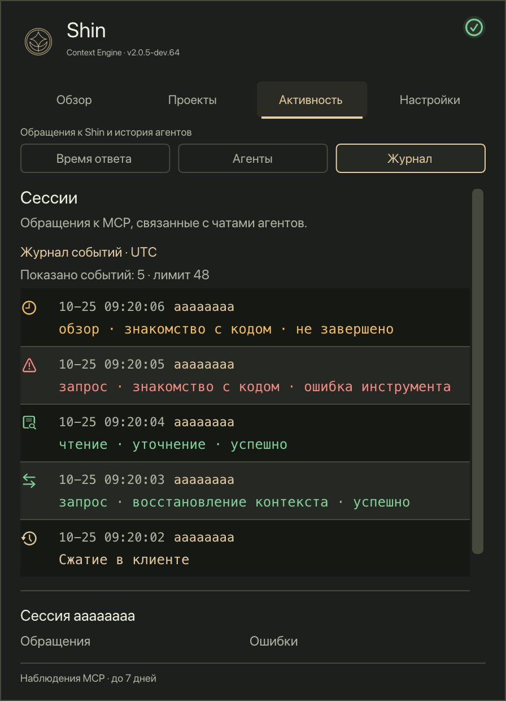

# UI screenshots

These PNGs are rendered by the actual macOS ImGui/Metal Monitor UI using the
synthetic scenarios in [layout_test.inc](../../observer/tray/layout_test.inc).
No live service, enrolled project, client usage history, or saved user preference
is read. Displayed metrics are fixture values, not performance measurements.

| README asset | Native fixture output |
| --- | --- |
| `monitor-overview.png` / `monitor-overview-ru.png` | `overview-warning-448x620.png` (EN / RU) |
| `monitor-settings.png` / `monitor-settings-ru.png` | `settings-448x620.png` (EN / RU) |
| `monitor-projects.png` | `project-states-448x620.png` |
| `monitor-project.png` | `search-warning-opened-448x620.png` |
| `monitor-timing.png` | `timing-retained-448x620.png` |
| `monitor-sessions.png` | `sessions-448x620.png` (EN) |
| `monitor-sessions-ru.png` | `sessions-448x620.png` (RU) |

After building the macOS kit with testing enabled, render again:

```sh
/tmp/shin-observer-kit/tray/shin-tray-layout-tests \
  /tmp/shin-monitor-screenshots -ShinHome /shin-monitor-test-home en
```

Metal must be available; a skipped render is not a new screenshot. Inspect the
outputs visually, then copy only the selected PNGs here without modifying
their pixels. Each image is rendered at 2x resolution. The screenshots use English; pass `ru` instead of `en` to render Russian.
Both languages use the same native views and synthetic scenarios.
These images show Overview, Projects, Activity and Settings, the navigation
introduced in preview dev.66. The
journal is inside Activity; its 48-event display ceiling, monospace text,
outcome colors and vector icons remain bounded. All images use the standard
448×620 panel size. EN and RU are generated into separate output directories.
The Overview warning is actionable inside the panel; the project-detail image
shows its search-check explanation and expected document. Settings exposes
language and labeled connection/storage/update actions. Russian Overview and
Settings are available as `monitor-overview-ru.png` and `monitor-settings-ru.png`.
The project list deliberately mixes ready, preparing, partial, blocked, on-demand,
waiting and recovering states to demonstrate their distinct colors and symbols.
The blocked project and displayed counters are synthetic examples. The
compact layout remains available. Memory curves retain observation gaps and
service-run boundaries.

<p>
  
  
</p>

## Terminal views

`tui-overview.svg` is the native FTXUI Overview renderer at 120×36 cells,
using the independent synthetic fixture in
[`sand_test.cpp`](../../observer/tui/sand_test.cpp). The same view is used by
`shin-ce stats`; no browser approximation, live service or private project is
used. The screenshot demonstrates ready, partial, preparing, blocked and
on-demand states. Its counters are fixture values.

The [screen gallery](../tui.md) also includes Projects, partial-coverage details,
Timing, Storage, Models, Russian, compact and disconnected views. These show
the four-section Sand layout included in preview dev.66 and later. The
underlying Sand renderer has shipped since preview dev.39.
All names, paths, tokens and counts are synthetic; example model labels do not
represent real client attribution.

The Overview, Timing, Russian, compact and offline captures also show graph
improvements included in dev.49 and later: visible measurement counts, the last
observed value and explicit period labels. Their values remain synthetic. Live-data diagnostic
captures are private and do not belong in this gallery.

After building Observer with testing enabled, refresh the gallery with:

```sh
/path/to/build/shin-tui-render-tests /path/to/disposable-captures
python3 observer/tui/capture.py --gallery /path/to/disposable-captures docs/images
```

The exporter preserves native cell text, colors, selection and weight.
Its only dependency is Python's standard library. Inspect the result visually;
terminal font and color capabilities still affect the actual application.
The JSON, plain-text and ANSI frame exports stay in the disposable capture
directory; only the selected SVGs belong in this documentation.

`tui-updates.svg` and `tui-update-progress.svg` show the Updates view included
in dev.49 and later. They come from `updates-offer-en.json` and
`updates-progress-en.json` in the same render fixture. To regenerate only these
two views:

```sh
python3 observer/tui/capture.py /path/to/disposable-captures/updates-offer-en.json docs/images/tui-updates.svg
python3 observer/tui/capture.py /path/to/disposable-captures/updates-progress-en.json docs/images/tui-update-progress.svg
```

## Project logo

`shin-logo.png` is the existing Shin project mark. PNG text metadata records
Shin Context Engine, Anton Petropavlovskiy and Apache-2.0. It contains no source
file paths or inherited EXIF/XMP metadata. The original pixel stream is preserved.
## Platform badges

`platform-macos.svg`, `platform-linux.svg` and `platform-windows.svg` are local,
project-authored vector badges for the README footer. Each links to the relevant
installation or build guide and distinguishes binary previews from source builds.
They contain no remote resources, scripts, screenshots or embedded fonts.

## Repository social preview

`social-preview.png` is the 1280×640 Sand card used by GitHub when a repository
link is shared. It is project artwork, not an application screenshot or a
performance measurement. Its PNG metadata identifies Shin Context Engine,
Anton Petropavlovskiy and Apache-2.0; it contains no inherited EXIF or XMP.

The editable source is `social-preview.svg`, which references the unchanged
`shin-logo.png` in this directory. It uses Avenir Next when available, with
Segoe UI and sans-serif fallbacks; fonts are not embedded or fetched remotely.
To regenerate, serve this directory locally, open the SVG in a browser and
export its exact 1280×640 canvas, excluding browser chrome and page margins.
Inspect the result and keep the PNG below GitHub's 1 MB upload limit.

Set the exported PNG in **Repository Settings → General → Social preview**.
The source image and GitHub's preview are independent: a Git commit alone does
not update the repository's Social preview setting.
