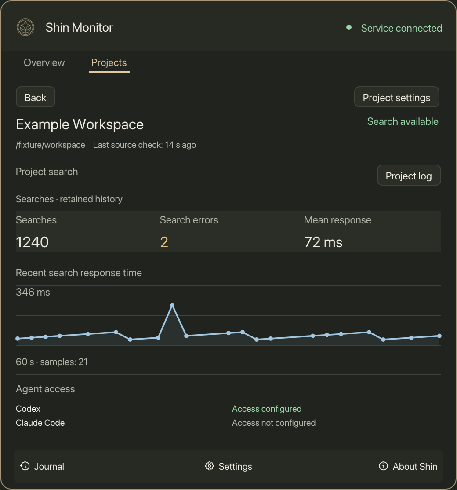
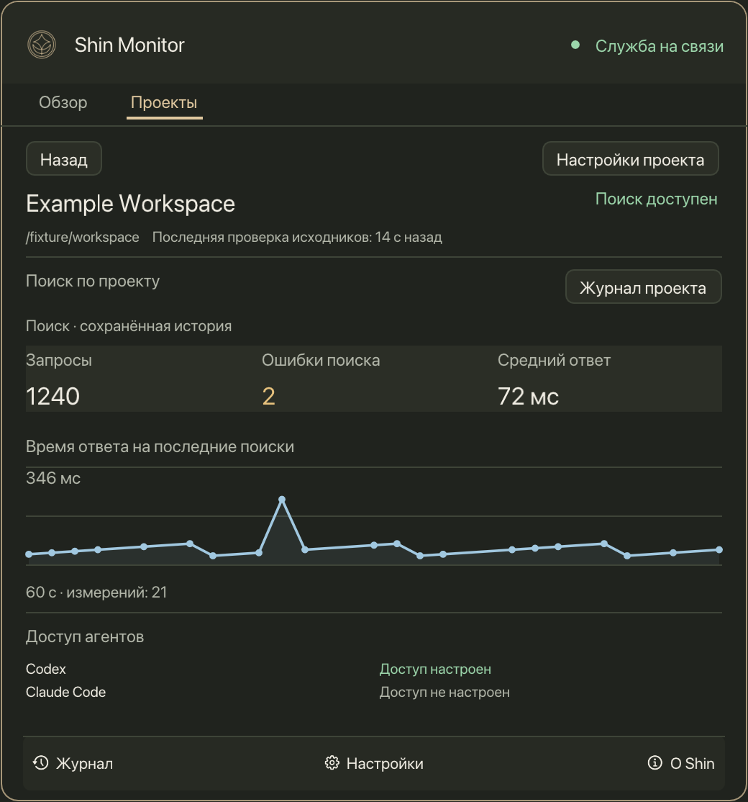
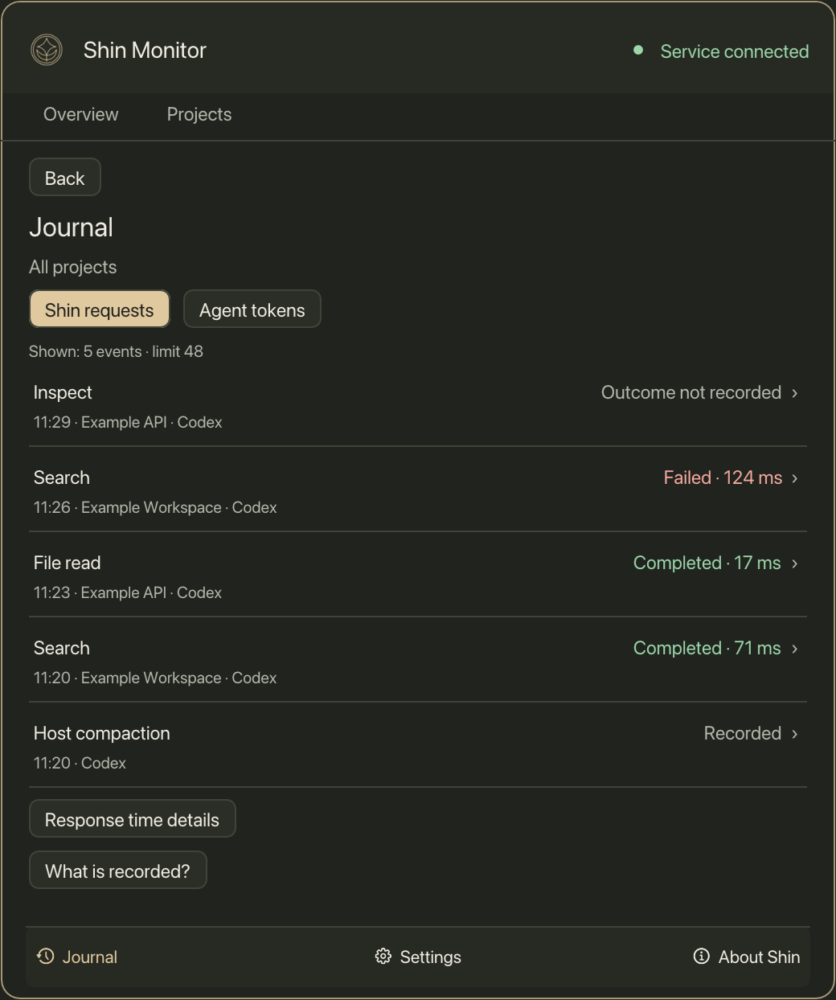
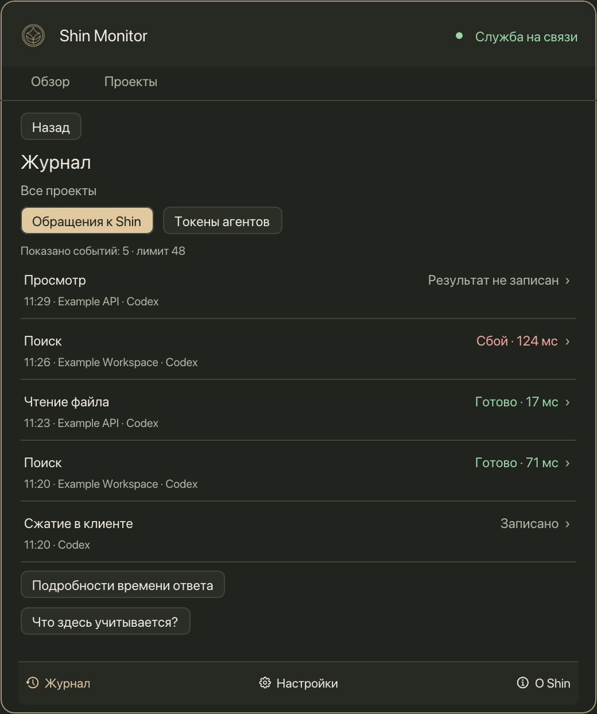
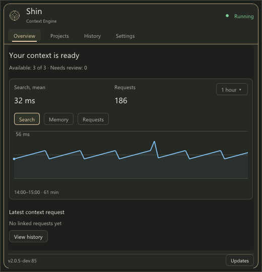
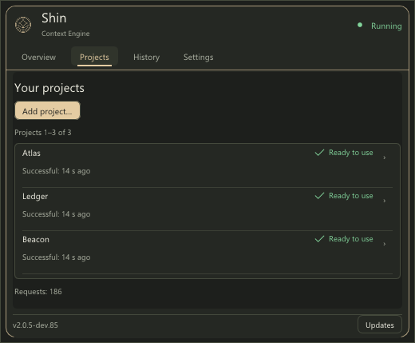

# UI screenshots

The macOS gallery was captured on **2026-11-20** with Observer dev.136 and
Core dev.37. The terminal Projects SVG was captured from the same source
build at 80×24. The other terminal SVGs come from the dev.98 source build.
Windows PNGs come from the published dev.98 ZIP (Core dev.18), rendered
in a signed-in session. Project names, activity, paths and measurements are
synthetic. [Windows tray and desktop Monitor](../windows-desktop.md#windows-quick-status-and-desktop-monitor).

## macOS Monitor

The macOS PNGs are rendered by the actual ImGui/Metal Monitor UI using the
synthetic scenarios in [layout_test.inc](../../observer/tray/layout_test.inc).
No live service, enrolled project, client usage history, or saved user preference
is read. Displayed metrics are fixture values, not performance measurements.
The Windows captures below show the earlier shared layout with Windows fonts,
icons and scaling. [Capabilities by platform](../README.md#capabilities-by-platform).

| README asset | Native fixture output |
| --- | --- |
| `monitor-overview.png` / `monitor-overview-ru.png` | `overview-warning-520x680-fit.png` (EN / RU) |
| `monitor-settings.png` / `monitor-settings-ru.png` | `settings-520x680-fit.png` (EN / RU) |
| `monitor-projects.png` / `monitor-projects-ru.png` | `project-states-520x680-fit.png` (EN / RU) |
| `monitor-project.png` / `monitor-project-ru.png` | `project-analytics-520x680-fit.png` (EN / RU) |
| `monitor-project-settings.png` / `monitor-project-settings-ru.png` | `project-settings-520x680-fit.png` (EN / RU) |
| `monitor-search-warning.png` / `monitor-search-warning-ru.png` | `search-warning-520x680-fit.png` (EN / RU) |
| `monitor-timing.png` | `timing-retained-520x680-fit.png` |
| `monitor-sessions.png` | `sessions-520x680-fit.png` (EN) |
| `monitor-sessions-ru.png` | `sessions-520x680-fit.png` (RU) |
| `monitor-about.png` / `monitor-about-ru.png` | `about-520x680-fit.png` (EN / RU) |

After building the macOS kit with testing enabled, render again:

```sh
/tmp/shin-observer-kit/tray/shin-tray-layout-tests \
  /tmp/shin-monitor-screenshots -ShinHome /shin-monitor-test-home en fit
```

Metal must be available; a skipped render is not a new screenshot. Inspect the
outputs visually, then copy only the selected PNGs here without modifying
their pixels. The screenshots use English; pass `ru` instead of `en` to render Russian.
The macOS images use a 520 px logical width and fit the page within a 680 px
ceiling. Retina captures are 1040 px wide. EN and RU use separate output
directories. Overview shows memory, requests and mean search time in line
charts. Memory curves retain observation gaps and service-run boundaries.
The project screen shows retained search totals, errors, response times and
agent access. Project settings groups access, exclusions, storage and
disconnection. Separate warning images show the cause and next action.
The Journal lists up to 48 events, with details on selection. Settings groups
language, startup, storage, updates and recording. About shows component versions.
The project list deliberately mixes ready, preparing, partial, blocked, on-demand,
waiting and recovering states to demonstrate their distinct colors and symbols.

<p>
  
  
</p>

[Project states in Russian](monitor-projects-ru.png) ·
[Project settings](monitor-project-settings.png) ·
[Project settings in Russian](monitor-project-settings-ru.png) ·
[Search warning](monitor-search-warning.png) ·
[Search warning in Russian](monitor-search-warning-ru.png).

<p>
  
  
</p>

[About Shin](monitor-about.png) · [About Shin in Russian](monitor-about-ru.png).

## Windows Monitor

The `monitor-windows-*` PNGs come from the native Win32/DX11 Monitor, using WARP
software rendering and the synthetic `documentation_main_views` fixture in
[windows_main.cpp](../../observer/tray/windows_main.cpp). They were captured in
a signed-in Windows desktop session through `--render-test` from the published
dev.98 portable ZIP, not produced from the macOS images or a browser mockup.
Its archive SHA-256 is `767f31ce1a96ffe550e07341016e38f0f85c9b3b658c59b06d5922f489db176f`,
matching the release's `shin-preview-windows.json` receipt.
No live service, enrolled project or client
history supplies their displayed data. These captures show native UI rendering;
they do not establish an installed MSI lifecycle or live-project readiness.

Each Windows PNG uses a 520 px logical/physical width at 100% display scaling
(1×). Height fits the content: Overview is 550 px, the three-project list 439 px,
and Settings 631 px in both languages. Original PNG bytes are preserved. The
macOS captures above retain their native 2× resolution. Native rendering and
adaptive-height checks passed, including shell integration, TaskbarCreated
recovery and physical clicks at 100%, 150% and 200% DPI; installed MSI update lifecycle
is a separate proof boundary.

| Documentation asset | Native fixture output, relative to the capture directory |
| --- | --- |
| `monitor-windows-overview.png` / `monitor-windows-overview-ru.png` | `monitor-overview-en.png` / `monitor-overview-ru.png` |
| `monitor-windows-projects.png` / `monitor-windows-projects-ru.png` | `monitor-projects-en.png` / `monitor-projects-ru.png` |
| `monitor-windows-settings.png` / `monitor-windows-settings-ru.png` | `monitor-settings-en.png` / `monitor-settings-ru.png` |

From the extracted dev.98 ZIP's `bin` directory, or a matching Windows desktop
build directory containing `shin-tray.exe`,
run in an unelevated, signed-in Windows desktop session at 100% scaling:

```powershell
.\shin-tray.exe --render-test C:\path\to\disposable-captures
```

The test writes both languages directly into the supplied capture directory,
alongside its other render checks and `result.json`. Inspect the output and copy
only the selected PNGs here, preserving their original bytes. Headless CI
rendering has a separate scope; see the
[Windows verification boundaries](../windows-desktop.md#package-publication-and-remaining-gates).

<p>
  
  
</p>

[Windows Settings](monitor-windows-settings.png) ·
[Russian Overview](monitor-windows-overview-ru.png) ·
[Russian Projects](monitor-windows-projects-ru.png) ·
[Russian Settings](monitor-windows-settings-ru.png).

## Terminal views

`tui-overview.svg` is the native FTXUI Overview renderer at 120×36 cells,
using the independent synthetic fixture in
[`sand_test.cpp`](../../observer/tui/sand_test.cpp). The same view is used by
`shin-ce stats`; no browser approximation, live service or private project is
used. The screenshot demonstrates ready, partial, preparing, blocked and
on-demand states. Its counters are fixture values.

The [screen gallery](../tui.md) includes a compact Projects example with warnings
on ready and on-demand projects, partial-coverage details,
Timing, Storage, Models, Russian, compact and disconnected views. These show
the four-section Sand layout included in preview dev.66 and later. The
underlying Sand renderer has shipped since preview dev.39.
All names, paths, tokens and counts are synthetic; example model labels do not
represent real client attribution.

The Overview, Timing, Russian, compact and offline captures also show graph
improvements included in dev.49 and later: visible measurement counts, the last
observed value and explicit period labels. Their values remain synthetic. Live-data diagnostic
captures are private and do not belong in this gallery.

After building Observer with testing enabled, refresh the gallery with:

```sh
/path/to/build/shin-tui-render-tests /path/to/disposable-captures
python3 observer/tui/capture.py --gallery /path/to/disposable-captures docs/images
```

The exporter preserves native cell text, colors, selection and weight.
Its only dependency is Python's standard library. Inspect the result visually;
terminal font and color capabilities still affect the actual application.
The JSON, plain-text and ANSI frame exports stay in the disposable capture
directory; only the selected SVGs belong in this documentation.

`tui-updates.svg` and `tui-update-progress.svg` show the Updates view included
in dev.49 and later. They come from `updates-offer-en.json` and
`updates-progress-en.json` in the same render fixture. To regenerate only these
two views:

```sh
python3 observer/tui/capture.py /path/to/disposable-captures/updates-offer-en.json docs/images/tui-updates.svg
python3 observer/tui/capture.py /path/to/disposable-captures/updates-progress-en.json docs/images/tui-update-progress.svg
```

## Project logo

`shin-logo.png` is the existing Shin project mark. PNG text metadata records
Shin Context Engine, Anton Petropavlovskiy and Apache-2.0. It contains no source
file paths or inherited EXIF/XMP metadata. The original pixel stream is preserved.
## Platform badges

`platform-macos.svg`, `platform-linux.svg` and `platform-windows.svg` are local,
project-authored vector badges for the README footer. Each links to the relevant
installation or build guide and distinguishes binary previews from source builds.
They contain no remote resources, scripts, screenshots or embedded fonts.

## Repository social preview

`social-preview.png` is the 1280×640 Sand card intended for GitHub repository
link previews. It is project artwork, not an application screenshot or a
performance measurement. Its PNG metadata identifies Shin Context Engine,
Anton Petropavlovskiy and Apache-2.0; it contains no inherited EXIF or XMP.

The editable source is `social-preview.svg`, which references the unchanged
`shin-logo.png` in this directory. It uses Avenir Next when available, with
Segoe UI and sans-serif fallbacks; fonts are not embedded or fetched remotely.
To regenerate, serve this directory locally, open the SVG in a browser and
export its exact 1280×640 canvas, excluding browser chrome and page margins.
Inspect the result and keep the PNG below GitHub's 1 MB upload limit.

Set the exported PNG in **Repository Settings → General → Social preview**.
The source image and GitHub's preview are independent: a Git commit alone does
not update the repository's Social preview setting.
