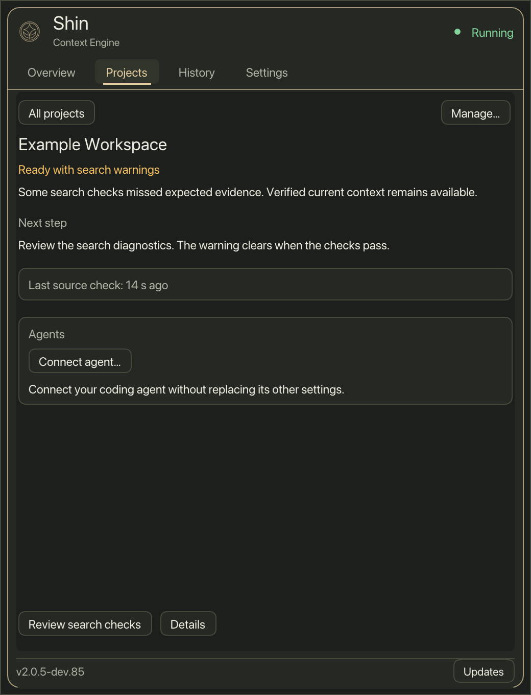
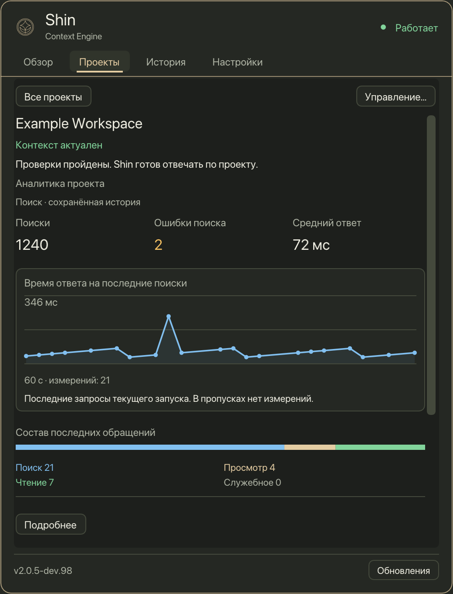
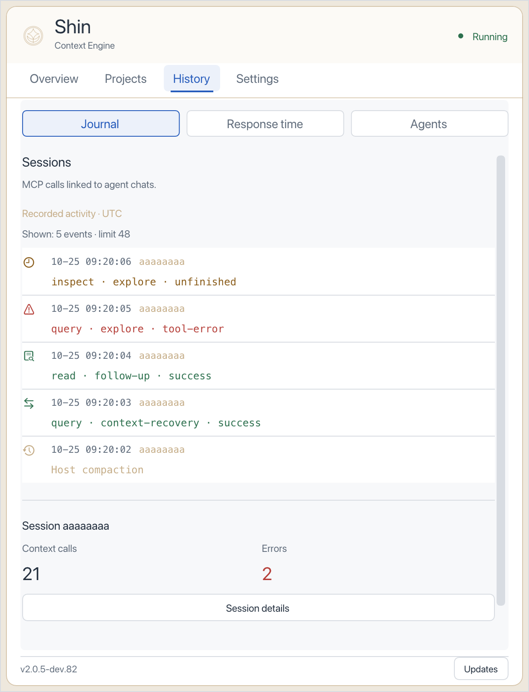
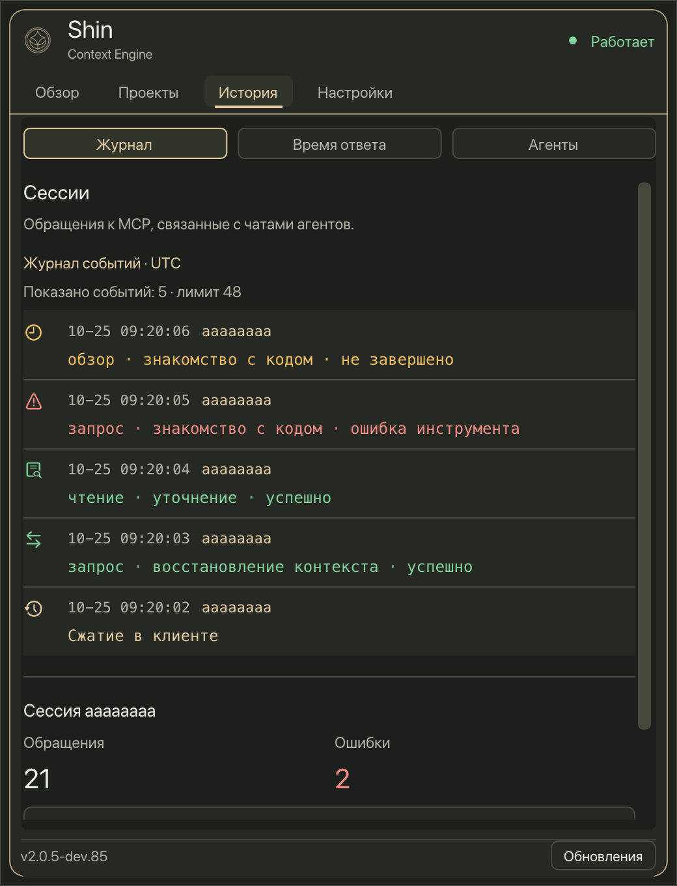
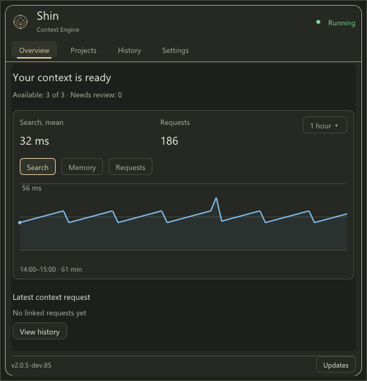
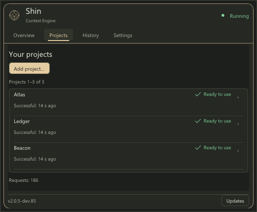

# UI screenshots

The gallery was refreshed on **2026-11-07**. macOS PNGs and terminal SVGs come
from the current source build (Observer dev.98, Core dev.19); the depicted UI is
available in native preview dev.98. The unreleased RE2 scanner is an engine change,
not a new UI capability. Windows PNGs come from the published dev.98 ZIP
(Core dev.18), rendered on a signed-in Windows Mini-PC. All displayed project
names, activity, paths and measurements are independent synthetic examples.

## macOS Monitor

The macOS PNGs are rendered by the actual ImGui/Metal Monitor UI using the
synthetic scenarios in [layout_test.inc](../../observer/tray/layout_test.inc).
No live service, enrolled project, client usage history, or saved user preference
is read. Displayed metrics are fixture values, not performance measurements.
The Windows captures below use the shared dashboard with their native system
fonts, icons, scaling and available actions;
see the [platform matrix](../README.md#capabilities-by-platform).

| README asset | Native fixture output |
| --- | --- |
| `monitor-overview.png` / `monitor-overview-ru.png` | `overview-520x680-fit.png` (EN / RU) |
| `monitor-settings.png` / `monitor-settings-ru.png` | `settings-520x680-fit.png` (EN / RU) |
| `monitor-projects.png` / `monitor-projects-ru.png` | `project-states-520x680-fit.png` (EN / RU) |
| `monitor-project.png` / `monitor-project-ru.png` | `project-analytics-520x680-fit.png` (EN / RU) |
| `monitor-search-warning.png` / `monitor-search-warning-ru.png` | `search-warning-520x680-fit.png` (EN / RU) |
| `monitor-timing.png` | `timing-retained-520x680-fit.png` |
| `monitor-sessions.png` | `sessions-520x680-fit.png` (EN) |
| `monitor-sessions-ru.png` | `sessions-520x680-fit.png` (RU) |

After building the macOS kit with testing enabled, render again:

```sh
/tmp/shin-observer-kit/tray/shin-tray-layout-tests \
  /tmp/shin-monitor-screenshots -ShinHome /shin-monitor-test-home en fit
```

Metal must be available; a skipped render is not a new screenshot. Inspect the
outputs visually, then copy only the selected PNGs here without modifying
their pixels. The screenshots use English; pass `ru` instead of `en` to render Russian.
Both languages use the same native views and synthetic scenarios.
These images show Overview, Projects, History and Settings. History opens with
the journal; timing and optional model usage remain available separately. Its
48-event display ceiling, monospace text, outcome colors and vector icons remain
bounded. These macOS images use a 520 px logical width and fit their height to
the page within a 680 px ceiling. Retina captures have a 1040 px pixel width;
height varies with content and language. EN and RU are
generated into separate output directories.
The main project-detail image shows retained search totals, errors, response
time and the recent request mix. The separate warning images show a search-check
explanation and next action. Overview shows healthy
context with its memory line graph and recent activity. Expected documents are
revealed by the explicit search-check review. Dark Sand surfaces,
compact type and labeled buttons distinguish actions from status
labels. Project connections belong with their projects, and technical reports
are disclosed separately. Settings groups language, storage and updates. Russian Overview and
Settings are available as `monitor-overview-ru.png` and `monitor-settings-ru.png`.
The project list deliberately mixes ready, preparing, partial, blocked, on-demand,
waiting and recovering states to demonstrate their distinct colors and symbols.
The blocked project and displayed counters are synthetic examples. The
compact layout remains available. Memory curves retain observation gaps and
service-run boundaries.

<p>
  
  
</p>

[Project states in Russian](monitor-projects-ru.png) ·
[Search warning](monitor-search-warning.png) ·
[Search warning in Russian](monitor-search-warning-ru.png).

<p>
  
  
</p>

## Windows Monitor

The `monitor-windows-*` PNGs come from the native Win32/DX11 Monitor, using WARP
software rendering and the synthetic `documentation_main_views` fixture in
[windows_main.cpp](../../observer/tray/windows_main.cpp). They were captured in
a signed-in Windows desktop session through `--render-test` from the published
dev.98 portable ZIP, not produced from the macOS images or a browser mockup.
Its archive SHA-256 is `767f31ce1a96ffe550e07341016e38f0f85c9b3b658c59b06d5922f489db176f`,
matching the release's `shin-preview-windows.json` receipt.
No live service, enrolled project or client
history supplies their displayed data. These captures show native UI rendering;
they do not establish an installed MSI lifecycle or live-project readiness.

Each Windows PNG uses a 520 px logical/physical width at 100% display scaling
(1×). Height fits the content: Overview is 550 px, the three-project list 439 px,
and Settings 631 px in both languages. Original PNG bytes are preserved. The
macOS captures above retain their native 2× resolution. Native rendering and
adaptive-height checks passed, including shell integration, TaskbarCreated
recovery and physical clicks at 100%, 150% and 200% DPI; installed MSI update lifecycle
is a separate proof boundary.

| Documentation asset | Native fixture output, relative to the capture directory |
| --- | --- |
| `monitor-windows-overview.png` / `monitor-windows-overview-ru.png` | `monitor-overview-en.png` / `monitor-overview-ru.png` |
| `monitor-windows-projects.png` / `monitor-windows-projects-ru.png` | `monitor-projects-en.png` / `monitor-projects-ru.png` |
| `monitor-windows-settings.png` / `monitor-windows-settings-ru.png` | `monitor-settings-en.png` / `monitor-settings-ru.png` |

From the extracted dev.98 ZIP's `bin` directory, or a matching Windows desktop
build directory containing `shin-tray.exe`,
run in an unelevated, signed-in Windows desktop session at 100% scaling:

```powershell
.\shin-tray.exe --render-test C:\path\to\disposable-captures
```

The test writes both languages directly into the supplied capture directory,
alongside its other render checks and `result.json`. Inspect the output and copy
only the selected PNGs here, preserving their original bytes. Headless CI
rendering has a separate scope; see the
[Windows verification boundaries](../windows-desktop.md#package-publication-and-remaining-gates).

<p>
  
  
</p>

[Windows Settings](monitor-windows-settings.png) ·
[Russian Overview](monitor-windows-overview-ru.png) ·
[Russian Projects](monitor-windows-projects-ru.png) ·
[Russian Settings](monitor-windows-settings-ru.png).

## Terminal views

`tui-overview.svg` is the native FTXUI Overview renderer at 120×36 cells,
using the independent synthetic fixture in
[`sand_test.cpp`](../../observer/tui/sand_test.cpp). The same view is used by
`shin-ce stats`; no browser approximation, live service or private project is
used. The screenshot demonstrates ready, partial, preparing, blocked and
on-demand states. Its counters are fixture values.

The [screen gallery](../tui.md) also includes Projects, partial-coverage details,
Timing, Storage, Models, Russian, compact and disconnected views. These show
the four-section Sand layout included in preview dev.66 and later. The
underlying Sand renderer has shipped since preview dev.39.
All names, paths, tokens and counts are synthetic; example model labels do not
represent real client attribution.

The Overview, Timing, Russian, compact and offline captures also show graph
improvements included in dev.49 and later: visible measurement counts, the last
observed value and explicit period labels. Their values remain synthetic. Live-data diagnostic
captures are private and do not belong in this gallery.

After building Observer with testing enabled, refresh the gallery with:

```sh
/path/to/build/shin-tui-render-tests /path/to/disposable-captures
python3 observer/tui/capture.py --gallery /path/to/disposable-captures docs/images
```

The exporter preserves native cell text, colors, selection and weight.
Its only dependency is Python's standard library. Inspect the result visually;
terminal font and color capabilities still affect the actual application.
The JSON, plain-text and ANSI frame exports stay in the disposable capture
directory; only the selected SVGs belong in this documentation.

`tui-updates.svg` and `tui-update-progress.svg` show the Updates view included
in dev.49 and later. They come from `updates-offer-en.json` and
`updates-progress-en.json` in the same render fixture. To regenerate only these
two views:

```sh
python3 observer/tui/capture.py /path/to/disposable-captures/updates-offer-en.json docs/images/tui-updates.svg
python3 observer/tui/capture.py /path/to/disposable-captures/updates-progress-en.json docs/images/tui-update-progress.svg
```

## Project logo

`shin-logo.png` is the existing Shin project mark. PNG text metadata records
Shin Context Engine, Anton Petropavlovskiy and Apache-2.0. It contains no source
file paths or inherited EXIF/XMP metadata. The original pixel stream is preserved.
## Platform badges

`platform-macos.svg`, `platform-linux.svg` and `platform-windows.svg` are local,
project-authored vector badges for the README footer. Each links to the relevant
installation or build guide and distinguishes binary previews from source builds.
They contain no remote resources, scripts, screenshots or embedded fonts.

## Repository social preview

`social-preview.png` is the 1280×640 Sand card intended for GitHub repository
link previews. It is project artwork, not an application screenshot or a
performance measurement. Its PNG metadata identifies Shin Context Engine,
Anton Petropavlovskiy and Apache-2.0; it contains no inherited EXIF or XMP.

The editable source is `social-preview.svg`, which references the unchanged
`shin-logo.png` in this directory. It uses Avenir Next when available, with
Segoe UI and sans-serif fallbacks; fonts are not embedded or fetched remotely.
To regenerate, serve this directory locally, open the SVG in a browser and
export its exact 1280×640 canvas, excluding browser chrome and page margins.
Inspect the result and keep the PNG below GitHub's 1 MB upload limit.

Set the exported PNG in **Repository Settings → General → Social preview**.
The source image and GitHub's preview are independent: a Git commit alone does
not update the repository's Social preview setting.
