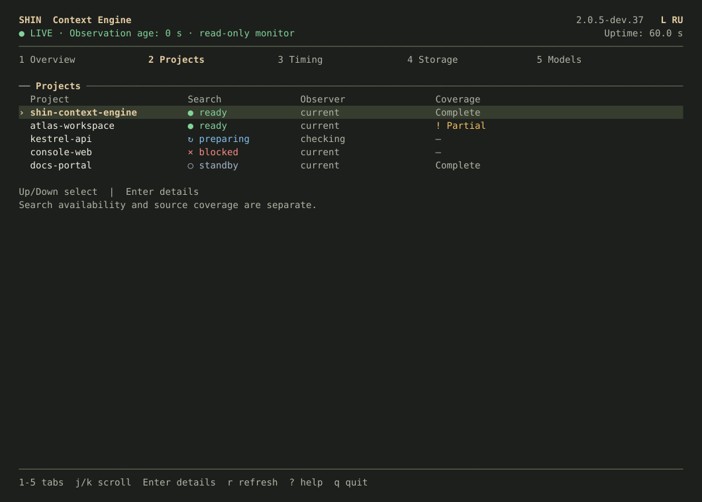
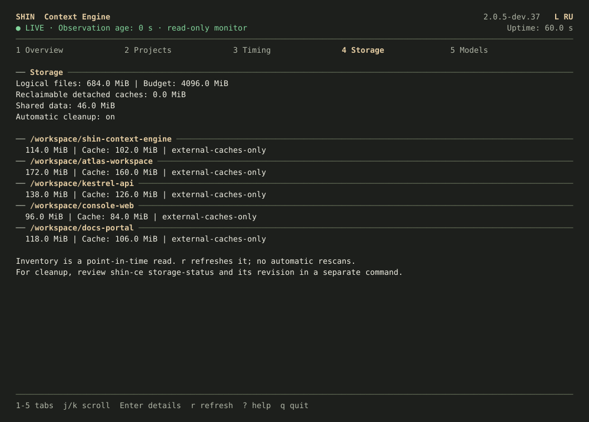
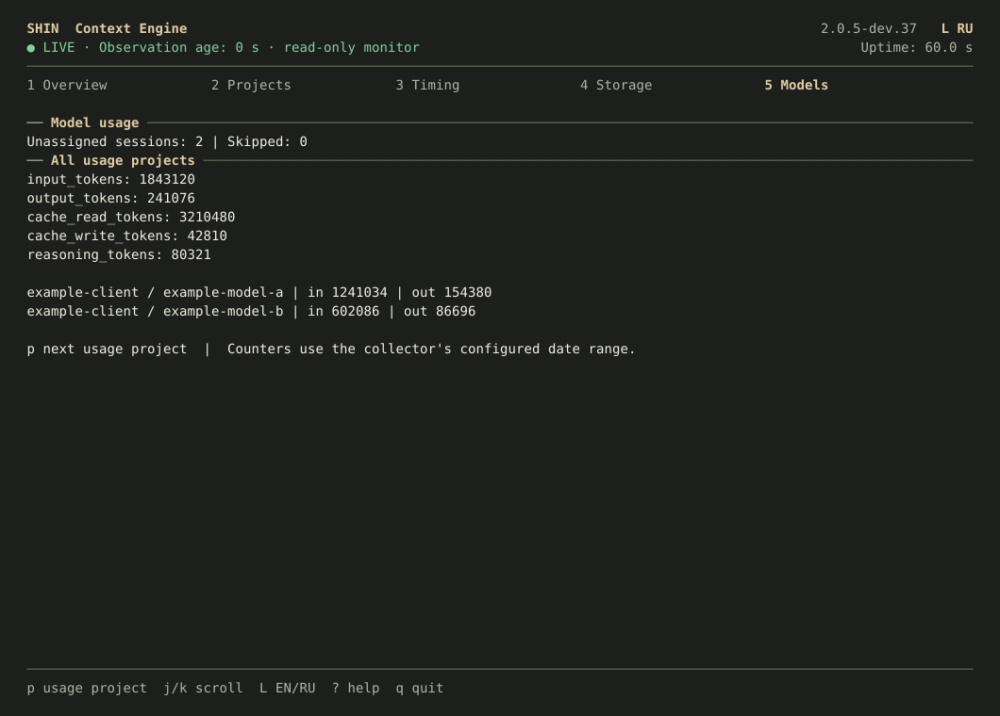
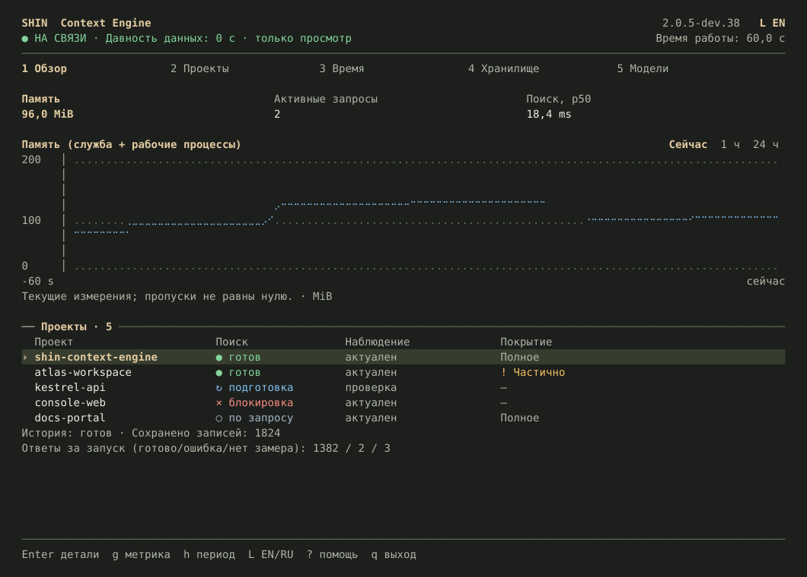
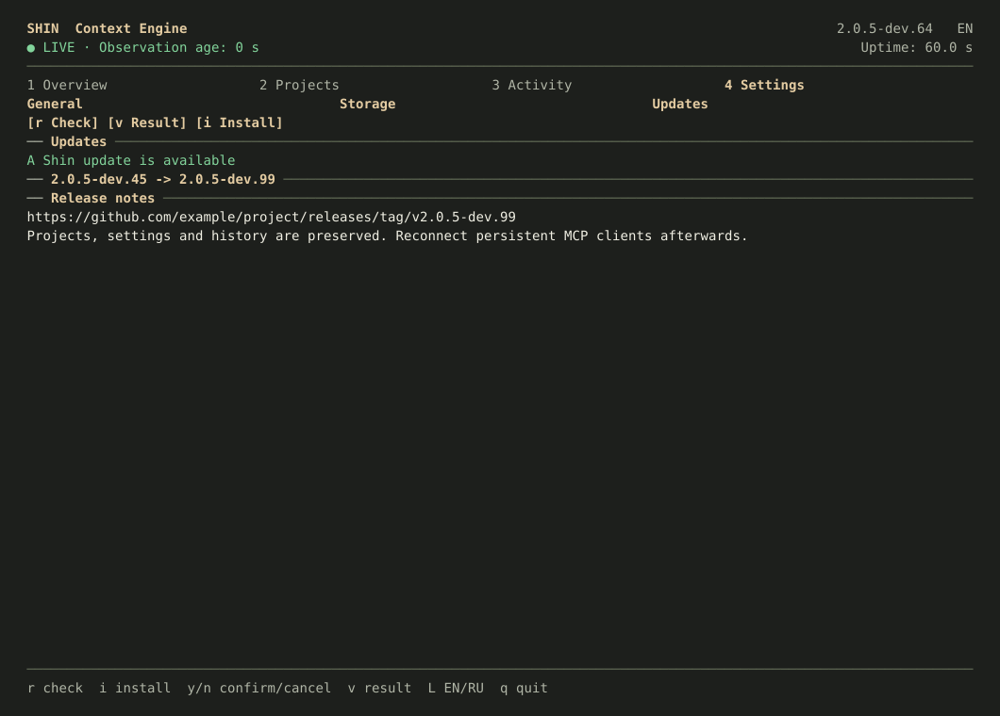
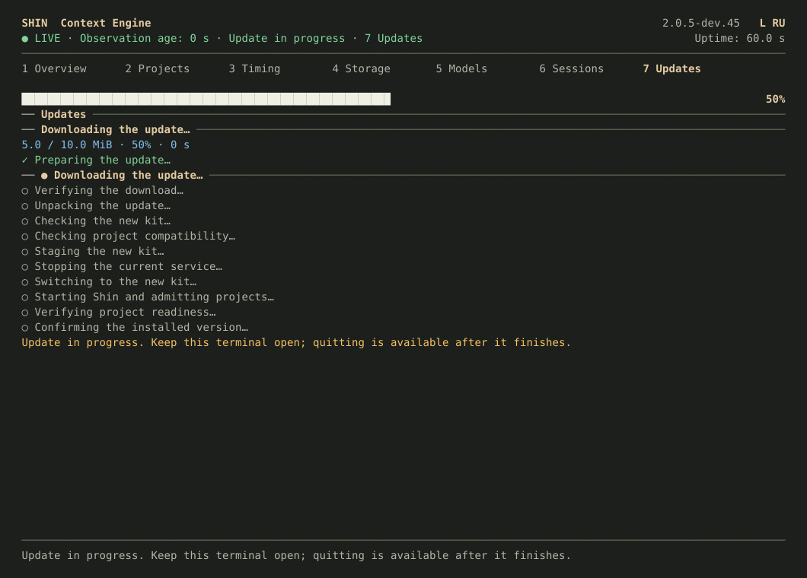
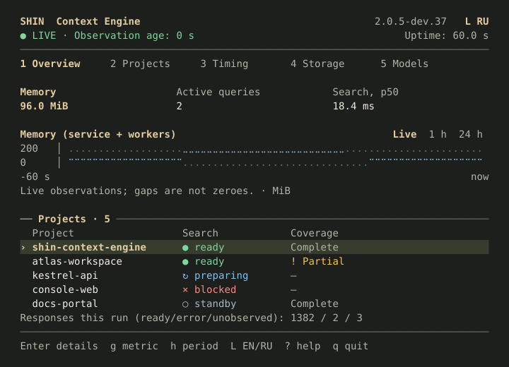
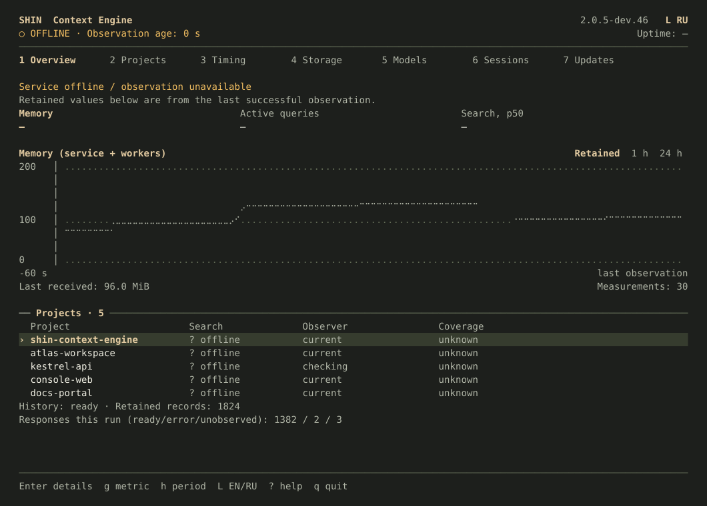

# Sand terminal monitor

`shin-ce stats` brings Monitor's Sand palette, project states and timing
calculations to an interactive terminal. The Sand TUI is included in preview
dev.39 and later; use the [preview kit](local-kit.md#download-a-preview-release)
on macOS or [build from source](building.md) on Linux.

Every image below comes from the actual FTXUI renderer with synthetic data.
Project names, paths, token counts, model labels and timings are examples,
not measurements of a real project or a performance claim. Your terminal
controls the font and available colors.

[Keyboard controls and usage](cli.md#interactive-terminal-monitor) ·
[Capture sources and reproduction](images/README.md#terminal-views)

## Overview

Memory, active queries and search p50 stay visible above a line graph and the
project table. Click a metric or press `g`; `h` cycles Live, one hour and 24 hours.
Missing observations remain gaps rather than becoming zero.

The graph improvements shown here are included in dev.49 and later. The chart footer
shows the last measured value and the number of visible measurements. Live covers
the last 60 seconds (or the elapsed uptime just after startup); retained views
show local start/end times. A lone measurement has a visible point marker.
Hourly memory observations remain separate points because those buckets cannot
identify service restarts. They are not joined into a continuous curve.

Large telemetry replies preserve a minute of live samples and recent requests
before removing bulky diagnostics. If essential status still needs that space,
the chart reports omitted measurements explicitly; omissions never become zeroes.

## Projects

Availability and source coverage have separate columns. A project can be
searchable with partial coverage; preparing and on-demand readers have their own
states. Use arrows or `j`/`k` to select a row, then Enter for details.

## Project details

Details show the cause, next step and excluded files when they are reported.
This example excludes one synthetic credential-like file while keeping the rest
of the project searchable.

## Timing

Search time, total service time and cold-reader preparation are shown separately.
`t` selects recent or retained measurements; `f` filters traffic. Diagnostic
requests stay identified, and missing attribution is not guessed.
The graph is explicitly labeled as live search time over the last 60 seconds;
the retained/recent selector applies to the timing summary below it. An idle
window says that no query timings are available for that minute.

## Storage

Storage shows usage, the configured budget and project caches. It is inspected
when this tab opens or when `r` is pressed. Cleanup remains an explicit CLI
operation with a reviewed revision.

## Models

The Models view reads the collector's normalized usage snapshot. Token counters
and model labels from client history are separate from attribution on individual
Shin requests. The example labels below are synthetic.

## English and Russian

Press `l` to change the current terminal session immediately, or launch with
`--language en` / `--language ru`. Automatic selection follows the terminal locale.

## Updates (dev.49 and later)

Open view 7 or press `u`. On macOS, `r` checks for a complete release and shows
the version and release-notes URL. `i` opens confirmation; `y` installs and
`n` or Esc cancels. Opening the view and pressing Enter never install anything.

Installation uses the same native verification and recovery path as Monitor.
The full plan, actual byte percentages, completed-project counts and stage elapsed
time remain visible. Quitting becomes available after installation settles;
`v` shows the saved result and `a` acknowledges it only when native status permits.
After success, restart the TUI and persistent MCP clients. Linux shows the
published-kit installer route instead of offering unsupported automatic downloads.

## Compact terminals

At 80×24 cells, the dashboard retains the main metrics, line graph and project
states. Extra width adds the observer column. The minimum is 60×12 cells;
noninteractive sessions can use text or JSON status instead.

## Disconnected service

When the service becomes unavailable, the last received observations remain
visible and are marked stale. The TUI reconnects automatically; it does not start
another service or change project enrollment.

