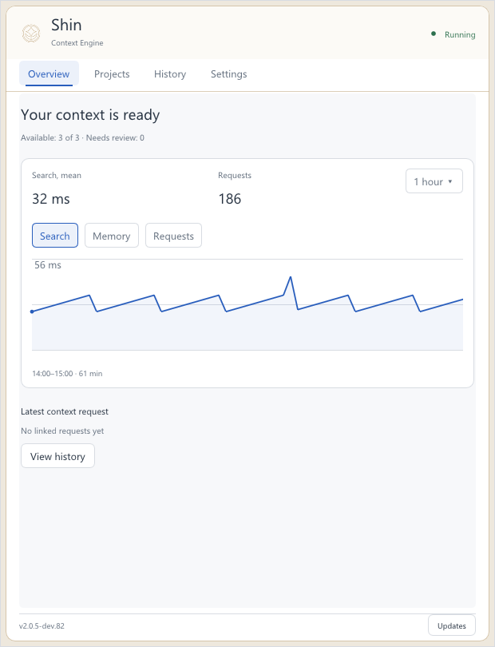
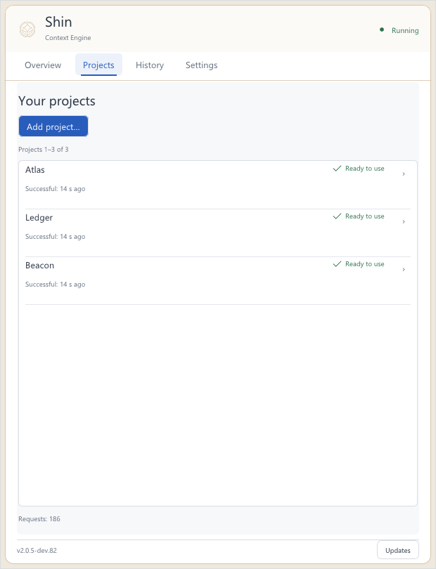

# Windows desktop preview

Windows support is an additional platform implementation of Shin. It uses the
same Core, profiles, generated-index contracts, Observer and MCP protocol as
macOS and Linux. It does not replace their implementations or qualification.

The development preview targets **Windows x64 on local NTFS**. Published
previews provide a portable ZIP and an MSI alongside the macOS kit. Hosted CI
qualifies the exact packages with its Windows smoke suite and headless rendering;
interactive desktop and installation lifecycle checks remain separate proof.

## Download a preview

Download the Windows files from [preview dev.77](https://github.com/toseek-samurai/shin-context-engine/releases/tag/v2.0.5-dev.77):

- `shin-desktop-2.0.5-dev.77-windows-AMD64.msi` for the installed desktop route.
- `shin-desktop-2.0.5-dev.77-windows-AMD64.zip` for a portable extraction.
- The matching `.sha256` file for each package. In PowerShell, compare it with
  `Get-FileHash -Algorithm SHA256 .\path\to\downloaded-package` before use.

Installation and new-project connection are separate steps. The MSI Finish action
prepares already enrolled projects and opens Monitor. In published previews, use
**Settings → Connect projects and agents…** to add a new project. See [MCP client setup](native-client-setup.md)
for connection review and manual integrations.

## Current scope

| Area | Current Windows preview behavior |
| --- | --- |
| Core and retrieval | Shared indexing, source discovery and snapshot-bound reads. Hosted smoke checks cover a selected native subset of the Core suite. |
| Observer, CLI and MCP | Native processes and authenticated named pipes; project work runs with unelevated user tokens and explicit root authority. |
| Storage and workers | Owner-private ACLs, Windows file identities, atomic replacement and bounded Job Objects. UNC paths and reparse traversal are refused. |
| Monitor | Win32/DX11 tray host, Sand, EN/RU, Overview, Projects, Activity and Settings; per-monitor DPI awareness with matching logical input. |
| Setup and management | Reviewed agent connections, project actions, storage management and Windows Startup Apps access. |
| Usage | Automatic collection from readable supported Codex, OpenCode and Hermes history; missing sources remain visibly unavailable or partial. |
| Updates | Automatic or manual release checks; confirmed MSI download/verification, normal UAC, project preparation and retained results. |
| Terminal UI | `shin-ce stats` is not implemented on Windows. |

Runtime binaries do not require WSL, Bash, Python, Node or a model service.
Python and the native compiler are development/test dependencies. WSL builds
exercise Linux and do not substitute for native Windows tests. Mixed-monitor
moves and interactive accessibility remain separate visual checks. See the
[platform capability matrix](README.md#capabilities-by-platform).

### Light Sand desktop redesign

Current development source uses the shared Light Sand interface with
**Overview**, **Projects**, **History** and **Settings**. It puts folder and agent
connections under Projects, opens History with the recorded-call journal, and
keeps timing, optional model usage and technical reports available as details.
Larger text, light content surfaces and compact labeled buttons separate actions
from passive status labels. Setup and update screens follow the same visual style.

This redesign is **not yet released**; dev.82 packages retain the published Sand
dashboard and its Activity section. The desktop redesign does not change the
reviewed client-configuration flow, native project authority, MSI installation
with UAC, or the updater's saved-result and recovery checks. The Linux/macOS
terminal interface remains dark Sand and is not a Windows TUI implementation.

<p>
  
  
</p>

These current-source captures come from the native Windows render test at 100%
display scaling; their data is synthetic. They are source-render evidence, not an
installed MSI or live-project test. See
[Windows Settings](images/monitor-windows-settings.png),
[Russian Overview](images/monitor-windows-overview-ru.png),
[Russian Projects](images/monitor-windows-projects-ru.png),
[Russian Settings](images/monitor-windows-settings-ru.png), and
[capture sources and reproduction](images/README.md#windows-monitor).

### Windows Monitor update screen

Open **Settings → Check for updates…**, or use the notification-area menu.
The check runs in the background and shows the running version and the
checking/current/available/error state. A complete newer release offers
**Download and install**, MSI/checksum links and release notes. Setup and update
pages stay visible when focus moves to another application.

Checks read public GitHub release metadata over HTTPS without account credentials
or project data. Existing version/channel rules apply; stable installations do
not receive development previews. Offers require exact repository URLs, complete
ZIP/MSI and checksum assets, bounded sizes and valid SHA-256 metadata. A failed
check does not stop Shin. The Settings opt-out disables automatic checks;
installation always requires confirmation and Windows UAC.

### Recover an update from dev.77 or earlier

These versions can report **Private path is unavailable or unsafe** after
**Download and install** and exit Monitor before starting the helper. The MSI's
registered directory has a trailing separator which that launch path rejects.
Use the published MSI and its matching checksum to update through Windows
Installer, then complete project setup and open Monitor. Uninstalling the
existing kit is unnecessary. Restart persistent MCP clients after the update.
The path error itself does not require an operating-system restart.

The published dev.82 kit accepts the MSI directory spelling while retaining
native identity, alias and reparse checks. Launch failures remain in Monitor
with a diagnostic action. After installer handoff, the helper reopens Monitor
only after verifying a complete known old or new kit; it retains Installer logs and
never retries an unknown installation automatically. New package qualification
also exercises the real registered MSI path and protected helper staging under a
standard-user token, before the guarded publisher accepts the package receipt.

## Monitor setup and updates

The following behavior is included in preview dev.74.

Windows packages preserve CRLF in bundled profile JSON independently of checkout
line endings. Project bindings pin exact profile bytes: packaging the same policy
from LF and CRLF checkouts must not create different approved revisions. Source
files and project-owned profiles are not rewritten; revision checks remain strict.

After Windows Installer confirms success and the installed inventory is verified,
the helper runs the **new installed** `shin-ce prepare-projects` as the ordinary
desktop user. Existing enrolled projects are prepared with their approved profiles
and original source/workspace identities, including a rebuild when Core changes.
Completion requires every enrolled project to be admitted by the current service.
Changed profile approvals, missing roots or concurrent enrollment changes remain
errors; preparation never accepts policy changes or reattaches detached projects.

The full MSI wizard offers a checked **Finish project setup and open Shin Monitor**
action. It runs the same helper unelevated after the Installer transaction has
finished. Monitor-initiated updates use passive Windows Installer progress, then
prepare projects explicitly. An unchecked Finish action or an independently run
quiet/passive MSI skips the desktop callback: run `shin-ce prepare-projects`
after installation, with `--home DIR` for a custom data home. `--check` only checks
the saved completion against the current kit, enrollment and live readiness.
No project data is changed by SYSTEM during the MSI transaction.

- The project setup and empty-state actions select and add a folder, discover supported agent configuration locations and
  let the user choose which configurations to change. **Review connections**
  precedes **Connect selected agents**. Codex, OpenCode, Command Code and Hermes
  reuse the shared lossless parsers, exact revision checks, private backups and
  atomic replacement. Other configuration is preserved; reconnect MCP afterward.
- **Projects → project → Project actions** provides agent connection,
  disconnection and storage access. Disconnecting preserves sources, indexes,
  history and settings. Cache deletion is separate, confirmed and tied to the
  exact storage-plan revision. A partial connection failure retains the completed
  results in the diagnostic report; it does not undo or repeat earlier writes.
- **Settings → Login settings…** opens Windows Startup Apps for Monitor.
  The machine MSI host continues to own the background service.
- The registered service collects readable Codex, OpenCode and Hermes history
  automatically. Missing or unsupported history remains visible as unavailable
  or partial. Windows paths with different slash/case spellings are matched only
  after confirming the same directory identity. History readers may coexist with
  active writers; ordinary Core readers retain immutable file sharing.
- The Monitor uses per-monitor DPI awareness and physical-resolution DX11 frames,
  with mouse positions converted into the same logical coordinates. Automated
  native checks cover physical clicks at 100%, 150% and 200%; mixed-monitor moves
  and interactive accessibility remain separate checks.
- Update checks run after startup and every six hours, with an opt-out and manual
  entry points in Settings and the tray menu. Checks use public metadata only.
  **Download and install** requires confirmation, copies the installed helper to
  private staging, rechecks the exact offer, downloads and verifies the MSI and
  checksum, then closes only the initiating Monitor and invokes Windows Installer
  with normal UAC. Stages and download bytes are shown; MSI owns installation
  progress and rollback. Portable ZIPs use manual MSI installation.
- **Last update result…** works offline. **Review previous update** refuses a live
  helper, can confirm an installed target only after checking its complete file
  inventory, and can acknowledge a known failure before installation. An unknown
  Installer outcome requires review and never silently starts another MSI.
  Project preparation has its own private `windows-setup` journal. The result
  page shows per-project errors even after ordinary MSI setup and offers
  **Retry project preparation** without reinstalling MSI or changing approvals.
  A failing project does not stop preparation of the others. Setup and update
  pages stay visible when another window gains focus.

Source and D3D11 render checks, exact-archive qualification and installed MSI
checks provide separate evidence. The local dev.72 rehearsal confirmed automatic
post-MSI project preparation and preserved project settings and history. New
installer changes require their own exact-package and installed checks.

## Build and verification

Use the matching checkout's `docs/building.md` for PowerShell commands and full
prerequisites. The [repository build guide](https://github.com/toseek-samurai/shin-context-engine/blob/main/docs/building.md)
also describes the distinction between local and hosted-runner checks.

- `windows-native` builds Core and native Observer tools; its
  `windows-native-smoke` test preset selects native Core checks.
- `windows-desktop`, from `observer/`, builds Observer/CLI/MCP and Monitor;
  its full test preset runs all checks registered in that configuration.
- `windows-desktop-smoke` is the hosted-runner subset. It does not include
  interactive desktop, full user-service lifecycle or protected-image checks.
- `windows-kit` builds production binaries for ZIP/MSI in a separate `kit/`
  directory. It does not register source tests; first run `windows-desktop`.

Keep the checkout and an absolute external `SHIN_BUILD_ROOT` outside AppData
and TEMP. Full local tests need an unelevated interactive desktop, symlink
creation rights for refusal fixtures, and a protected machine-image test fixture
(CMake by default; the build guide describes an explicit override). Do not substitute an
elevated shell for the user-runtime checks. The source workflow uploads test
reports. The guarded publisher requires Windows package qualification before
making a preview release public.

The shared refresh regressions cover initial bootstrap, refresh and cached
queries when documentation has a broken local link, warning retention and
clearing after repair. Only the known link-only bootstrap warning is tolerated;
permanent profiles and other safety, freshness and integrity failures remain
strict. Tests use independent disposable state rather than installed projects.

## Runtime and installation boundaries

A source build does not install Shin, register an SCM service or enroll a real
project. Development CLI use must select its own project and data home; a
project's sources and its private index/history must remain separate. Use the
same matching binaries and home for CLI, MCP and Monitor.

The Windows MSI design installs a machine-owned `ShinObserverHost` supervisor
under LocalSystem. That host starts separate unelevated runtimes for existing
and newly signed-in user sessions. Project observation, indexes and queries
belong to those user runtimes. The native service-definition command describes
this model; it does not prove that a matching service is installed or healthy.

Monitor starts separately. Closing its window does not stop an already running
Observer. Installation does not enroll projects or rewrite client configuration.
Project sources, indexes, history and credentials are outside the MSI payload
and must be preserved during maintenance and removal.

## Installer presentation checks

The source MSI wizard uses Shin branding, Segoe UI and separate welcome,
preview-notes, confirmation, progress and completion pages. The confirmation
shows the fixed protected Program Files destination. Repair and removal use
the standard WiX maintenance dialogs. Hosted package inspection checks the
MSI's metadata and payload; it does not execute the interactive installation,
repair, upgrade or uninstall workflow.

Use CPack 4.3+ and WiX 4 with matching UI/Util extensions. With the external
`SHIN_BUILD_ROOT` from the build guide still set, run from the checkout root:

```powershell
Push-Location observer
cmake --preset windows-kit
cmake --build --preset windows-kit
cpack --config "$env:SHIN_BUILD_ROOT/kit/CPackConfig.cmake" -C Release -G ZIP
cpack --config "$env:SHIN_BUILD_ROOT/kit/CPackConfig.cmake" -C Release -G WIX
$version = (Get-Content VERSION -Raw).Trim()
$zip = "$env:SHIN_BUILD_ROOT/kit/packages/shin-desktop-$version-windows-AMD64.zip"
$msi = "$env:SHIN_BUILD_ROOT/kit/packages/shin-desktop-$version-windows-AMD64.msi"
python -B tests/windows_kit_test.py $zip --msi $msi
Pop-Location
```

Run this archive check unelevated in an interactive session. It verifies both
package identities, hashes, runtime dependencies, relocated Monitor renders,
and init/query/stop using disposable project data. MSI inspection is read-only;
no installation actions execute. Stop on a failed command before proceeding.
Keep the exact archives and their `.sha256` files together.

For MSI-only metadata checks or visual dialog previews, from the checkout root:

```powershell
python observer/tests/windows_msi_test.py $msi --phase metadata
python observer/installer/preview_windows_msi.py $msi --dialog WelcomeDlg
```

Set `$msi` to the absolute package path. Repeat the preview for
`LicenseAgreementDlg`, `VerifyReadyDlg`, `ProgressDlg`, `ExitDialog`,
`MaintenanceWelcomeDlg`, `MaintenanceTypeDlg`, `FatalError` and `UserExit`.
The helper opens the MSI database read-only with `MsiEnableUIPreview` and
automatically closes after 60 seconds (`--seconds` changes the interval).
It does not run installation actions. Preview properties are not populated by
costing or an installation session, so the destination and some conditional
controls may be absent; check their actual behavior in a disposable installed
lifecycle test. Metadata checks also verify wizard navigation, note acceptance,
the protected root and the Monitor launch action.

Artwork is checked in under `observer/installer/assets`; normal packaging
does not regenerate it. To refresh it from the project logo on Windows, run
`python observer/installer/generate_windows_branding.py` with Pillow installed.
Keep the WiX bitmap canvases at 493 x 58 and 493 x 312 pixels.

## Package publication and remaining gates

The [unified CI](../.github/workflows/ci.yml) requires both Windows source jobs and
the exact Windows package proof before publishing Windows downloads. Linux,
macOS and Windows qualify independently; another platform's pending runner does
not block a qualified platform. The Windows desktop job builds ZIP/MSI with pinned CPack 4.3.5 and WiX
4.0.6. Qualification checks the compiled MSI identity, UI, upgrade bounds and
SCM actions, compares its extracted payload byte-for-byte with the ZIP, and runs
native Monitor rendering plus init/query/stop from the relocated ZIP under a
standard user. A receipt binds these checks to the commit, run attempt and exact
asset hashes. Failed or missing Windows proof prevents publication of Windows
downloads. Its `shin-preview-windows.json` receipt preserves that provenance when
another platform's qualified assets are added to the same preview.

`qualify_windows.ps1` creates a temporary standard account only on disposable
GitHub-hosted VMs, then removes the account/profile. It does not change
UAC or install an MSI. The runtime test uses a private temporary project and home;
A bounded child process runs with that user's loaded profile; Monitor renders
with software D3D11/WARP. A short preflight checks the launcher before compilation.
The CI account has no Explorer shell: `--render-headless-test` retains all 65
rendered states, action bounds, focus-loss and Escape checks, and reports
`shell_integration=false` and `taskbar_recreated_event=null`. The receipt records
`render_scope=headless`; it never certifies notification-area integration.
The default `--render-test`, the full local CTest preset and `windows_kit_test.py`
without `--headless-render` still require actual icon registration and recovery
after `TaskbarCreated` in a signed-in Windows session.

Real interactive-session installation, repair, upgrade, downgrade refusal,
uninstall/reinstall and data/history preservation were rehearsed for the dev.54
packaging policy. That is separate installed evidence, not a claim that every
hosted package check repeats the lifecycle rehearsal. Changes to installer or
SCM behavior still need a new installed rehearsal, including multi-user and
rollback scenarios where affected. The local dev.72 rehearsal additionally covered
MSI upgrade and automatic project preparation. Reviewed client setup, automatic
usage collection and MSI updates are available in dev.74; the Windows TUI remains
unimplemented. The rehearsal does not certify all future payloads or every
multi-user, restart and rollback scenario.

Linux/macOS gates, Windows source checks, exact-archive checks and installed
service checks retain separate proof boundaries. Local binaries never substitute
for the CI artifact that is published.

## MSI version policy

Windows Installer compares only three numeric fields, bounded by
`255.255.65535`; a fourth field is ignored. See Microsoft's
[ProductVersion contract](https://learn.microsoft.com/en-us/windows/win32/msi/productversion).
The kit and UI retain the full Shin version. The internal MSI version is
`major.minor.(patch * 1000 + channelOffset)`:

| Shin version | MSI ProductVersion |
| --- | --- |
| `2.0.5-dev.53` | `2.0.5053` |
| `2.0.5-dev.54` | `2.0.5054` |
| `2.0.5-rc.0` | `2.0.5900` |
| `2.0.5` | `2.0.5999` |
| `2.0.6-dev.0` | `2.0.6000` |

Development serials occupy offsets 0–899; release candidates use 900–998;
stable uses 999. This policy supports major/minor 0–255, patch 0–64,
dev serial 0–899 and rc serial 0–98. Packaging fails for unsupported values or
noncanonical versions instead of truncating, wrapping or reusing an identity.
These are MSI packaging bounds, not runtime or indexing limits.

The existing UpgradeCode stays constant. ProductCode is a deterministic UUIDv5
of `windows-x64:<full Shin version>` in that UpgradeCode namespace: the same
version has the same product identity; a new version has a different one.
Compiled-MSI checks verify these values, older-version removal bounds and the
downgrade refusal. The ZIP and MSI must describe the same full version.
Never replace a published archive with changed bytes under the same version.
Packaging retains CPack's installed WiX 4 template and disables its default
same-version replacement. If the expected template fragment changes, packaging
fails for review. Normal maintenance of the same ProductCode remains separate
from replacing one version with another.
